# Yeetwork

A colorful, chaotic multiplayer physics playground for **Godot 4.7 (Forward+)**.
Gravity guns, Quake/Unreal-style movement, destructible arenas, goofy ragdolling
characters and spectacularly unfortunate accidents.

> The fun comes from what players can do with the systems, not from being told what to do.

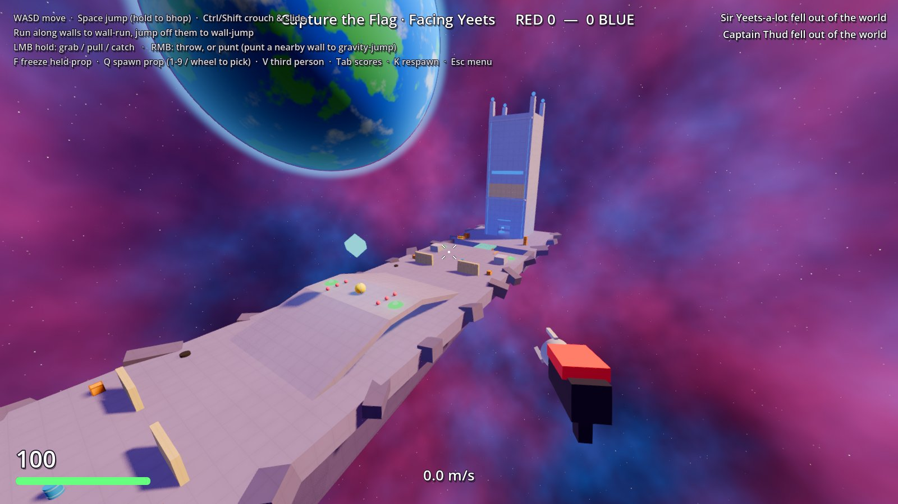

| | |
|---|---|
| 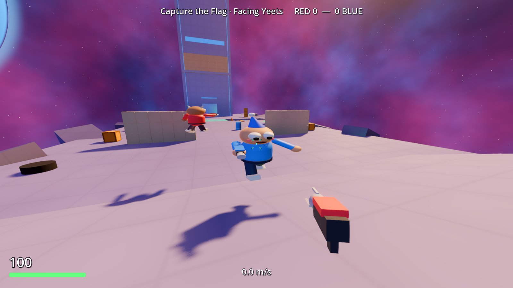 | 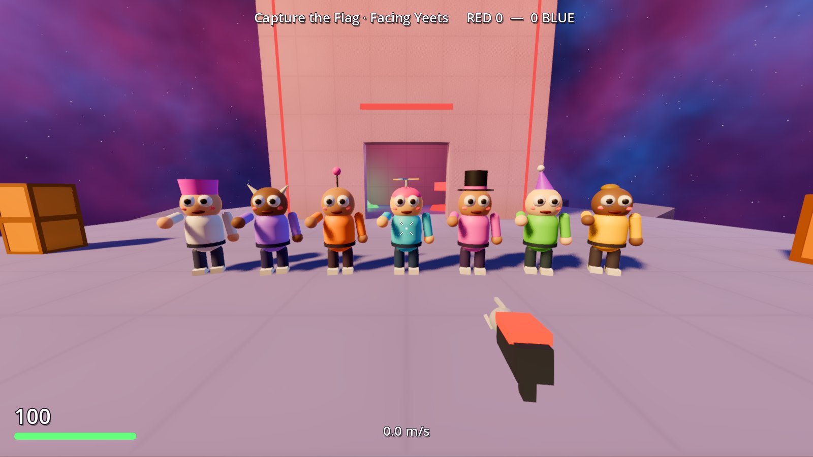 |
| 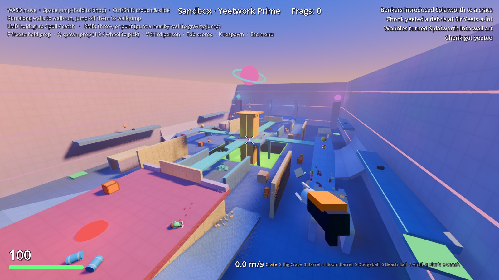 | 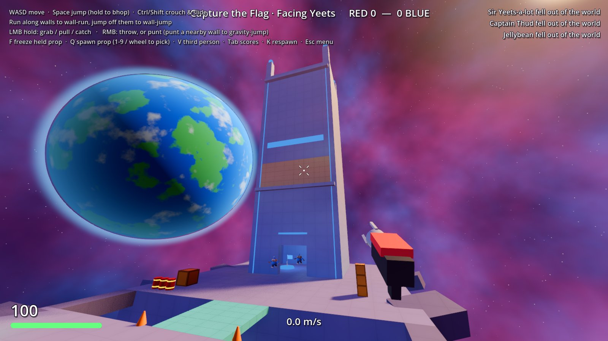 |
| 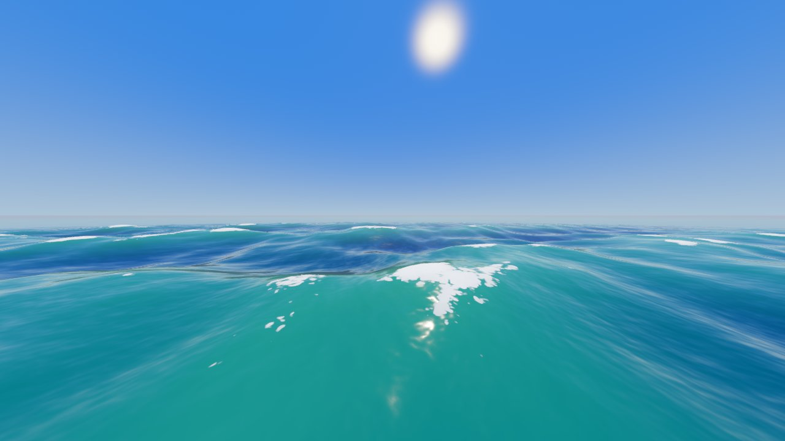 | 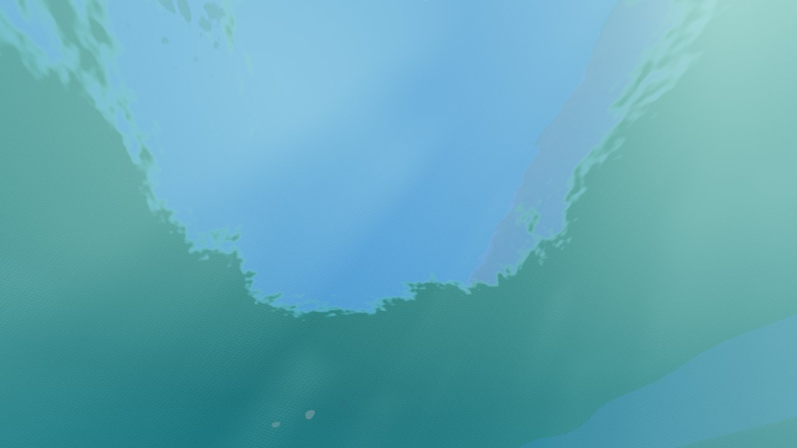 |
| 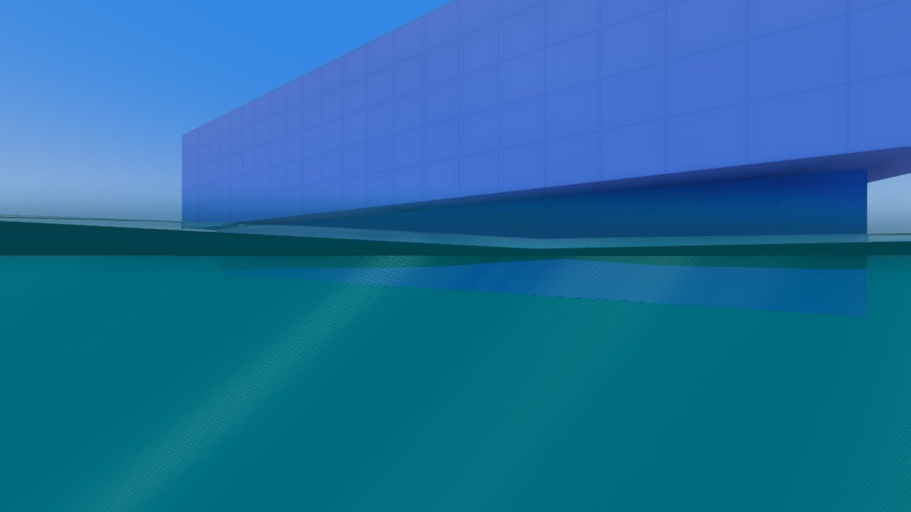 | 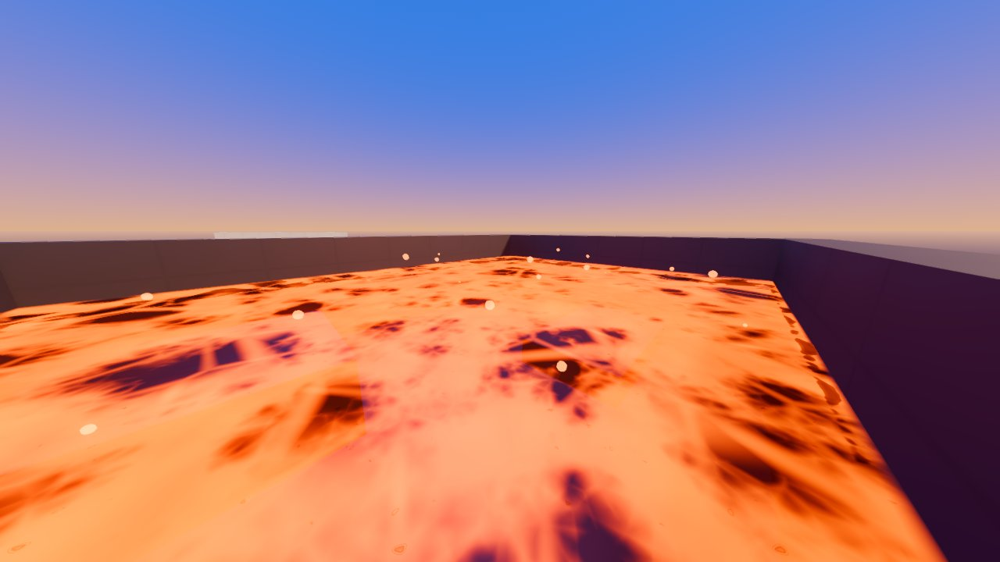 |
| 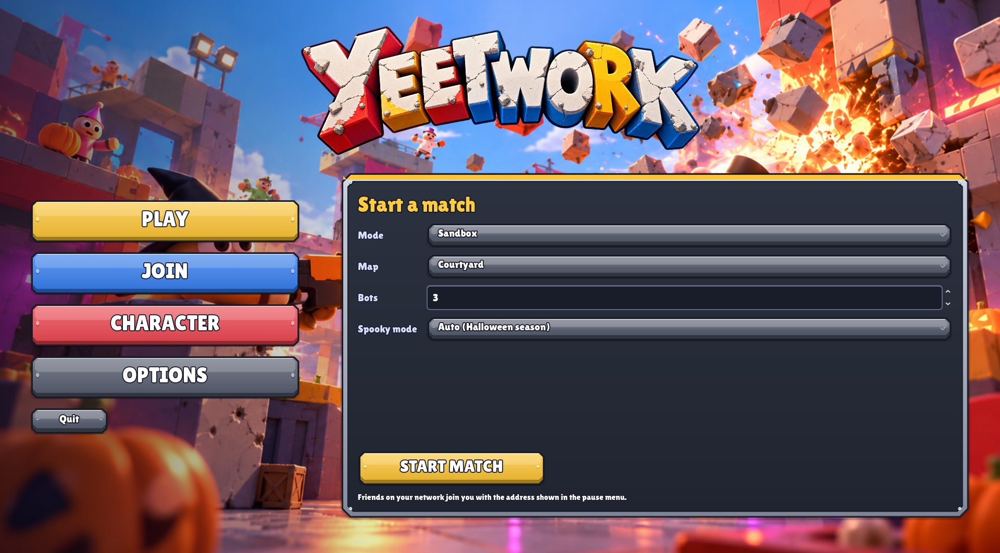 | 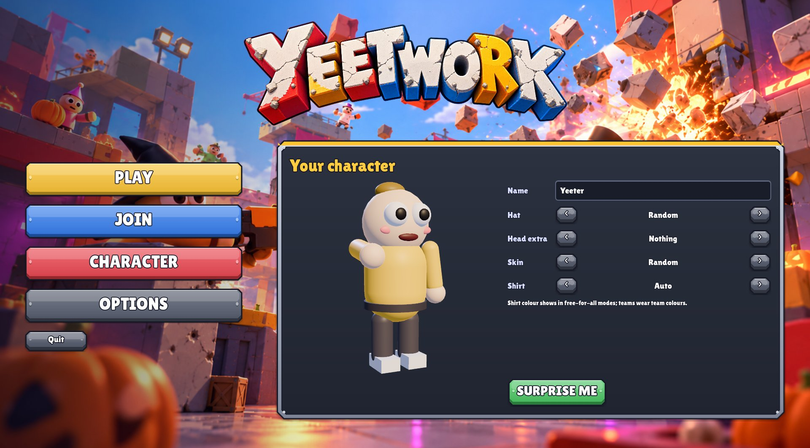 |
| 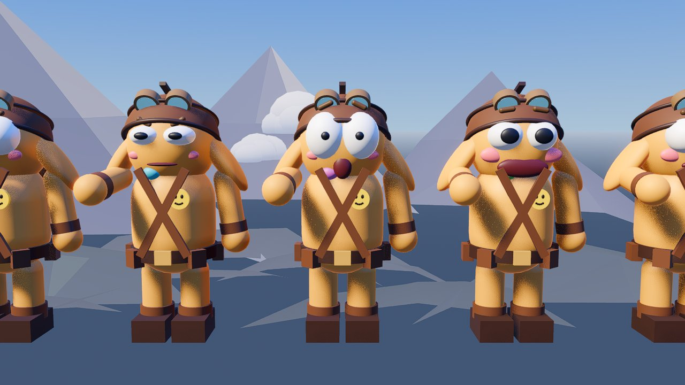 | |

## Downloads: Windows, Linux & Steam Deck

GitHub Actions builds **Windows** and **Linux** versions on every push (see the *Actions*
tab → *Test & Export* → Artifacts). Tagging `v*` publishes a Release. The Linux build
runs natively on the **Steam Deck** with controller support and a Deck graphics preset.
The step-by-step install and multiplayer guide is in **[docs/STEAM_DECK.md](docs/STEAM_DECK.md)**.

## Running

1. Install **Godot 4.7** (standard build, no .NET needed).
2. Open `project.godot` and press **F5** (or run `godot --path .`).
3. In the menu: **PLAY** (pick mode, map, bots and water style, then *Start match*),
   **JOIN** (a friend's address), **CHARACTER** (name, hat, head extra, skin, shirt) and
   **OPTIONS** (display: windowed / borderless / fullscreen, window size, monitor, brightness,
   camera shake, FPS counter; controls, sound and graphics). Friends on your network (or with the port
   forwarded) join with your IP. The default port is `24642` (UDP).
   If your ISP doesn't let you host (CGNAT), run a UDP tunnel such as **playit.gg** pointed
   at local UDP port `24642`; friends paste the address it gives you (`host:port`) into
   **Address** (or `--join host:port`).

Geometry, materials, characters and sounds are generated in code. The only assets are the
menu art and font (`assets/`): the title background and logo, button and frame art made by
`tools/make_ui_art.py`, and the Lilita One font (SIL Open Font License, `assets/fonts/OFL.txt`).

## Controls

| Action | Keys |
|---|---|
| Move | WASD |
| Jump (hold to bunny hop) | Space |
| Swim up / dive (in water) | Hold Space / hold Ctrl. Swim into a ledge holding Space to climb out |
| Run (hold) | Shift. Settings → *Always run* flips it so Shift walks |
| Crouch / slide (slide only while running) | Ctrl or C |
| Gravity gun: grab, pull, catch | Hold left mouse |
| Throw held object (hold to charge) / punt | Right mouse |
| Freeze held prop (sandbox building) | F |
| Grapple hook (hold: hang on and reel in; hold Ctrl to let rope out) | G or middle mouse (gamepad R3) |
| Push / pull held object | Mouse wheel (while holding) |
| Rotate held prop | Hold E + move mouse |
| Use (puzzle buttons, the Reset button; empty hands) | E (gamepad X) |
| Spawn prop (sandbox) / pick prop | Q / 1-9 or mouse wheel (when not holding) |
| Third-person camera | V |
| Scoreboard | Tab |
| Respawn | K |
| Menu and settings | Esc |
| Fullscreen on / off | F11 or Alt+Enter |

Gamepads work too (sticks, triggers for the gun, A jump, B crouch).

Everything can be rebound in **Options → Controls** (and in the pause menu): one keyboard or
mouse binding and one gamepad binding per action. **Swap mouse buttons** puts the grab on the
right button and the throw on the left. The in-game hints show your own bindings.

## What's in it

**Gravity gun.** A chunky toy sci-fi gun with a glowing core and three claws, modelled in
Blender (`art/gravity_gun/gravity_gun.blend`, built by `tools/make_gravity_gun.py`; its
orange parts take your team colour). Grab, carry, pull, push and throw. Pulled objects lock on and come to
you even if your aim drifts. Holding the trigger catches incoming objects, including
dodgeballs. Push or pull what you hold, and rotate props to line up a build or a shot. You can grab players: teammates for up to 6 s, enemies only briefly, and
throw them across the map. Hold the throw button to **charge** a throw: the object shakes and the crackling
electric arc goes white-hot, and a full charge yeets about 1.8× as hard. Punt everything in a cone. Punt a
wall right in front of you to gravity-jump. Thrown objects inherit your velocity, so moving fast means throwing hard.

**Grapple hook.** Hold G (or the middle mouse button, R3 on a gamepad): it takes hold of the
level and reels you up to it, swinging on the rope; let go to drop. Hook a light prop and
it's yanked over to you; a heavy one and you're reeled in to it; a friend and they're yanked
to you (pull them up a ledge). Puzzle levels let it take hold only on yellow grapple rings
(MapSettings → Grapple), so it can't skip the puzzles.

**Movement.** Quake-style ground and air acceleration (strafe jumping, bunny hopping),
CPM-style air control, crouch slides with slope gravity, wall running, wall jumps,
ramp jumps that keep upward momentum, slope landings that turn falls into speed,
jump pads, lifts, acid that bounces you, gravity jumps, and swimming.

**Water, acid and lava.** Two water styles, picked by the host on the Play page:
*Classic*, and *Sculpted*, which has sharper ridged crests, broad troughs, foam that
stretches with the waves, ripples and foam rings where things hit the water, wakes behind
anything moving through it and churned whitewater after explosions. Sculpted seas come in
calm, lake, ocean and stormy states (`MapSettings → Ocean Preset`).
Liquids have Gerstner waves that roll in irregular sets, foam
where crests fold over and along shores, sun glints, light glowing through thin crests,
refraction with depth absorption (red fades first), caustics, and screen-space
reflections. With your eyes at the surface the view splits above and below the
waterline. Underwater there is fog, light shafts and Snell's window, and sound is muffled.
In pools you float with your head out, hold jump to swim up and crouch to dive. Wood,
rubber and soft props float and bob on the waves; metal and stone sink. Big splashes
hit everyone's screen. The open ocean around a map is too rough to swim in: fall in and
you sink and drown ("sleeps with the fishes"). Acid and lava bounce and burn you, and lava
has drifting plates of cooled crust.

**Fire.** Explosions set wooden things alight (crates, barrels, planks, couches, boards),
and so do burning places (Lagoon has a bonfire). Fire is drawn as soft, glowing cartoon
flames: one metaball mass hugging the burning thing, see-through in the middle with a
bright edge, rounded tongues that stretch, curl and pinch off droplets, plus a glowing shell,
smoke, light and crackle. Burning things hurt players next to them and spread to their
neighbours; wood burns down into smouldering boards; a burning boom barrel cooks off.
Players on fire take damage for a few seconds unless they jump into water.

**Weather.** Rain is reusable on any map (`MapSettings → Weather`); the storm adds wind
wisps, lightning and thunder.

**Player physics.** Players are physics objects: they get launched, held, thrown and
knocked down (tumbling ragdoll state). Thrown players smash through breakable walls,
bowl over other players (the thrower gets the credit) and splat against scenery. Death
spawns a full joint-based ragdoll corpse.

**Destruction.** Every breakable slab (walls, bridges, tunnel roofs, windows) is cut into a
seeded irregular Voronoi pattern of cells with noisy, jagged outlines. When cells break,
the slab mesh and collision are rebuilt, so holes are real geometry you can fly through.
- **Impacts leave different damage.** Fast small objects punch small holes ringed by
  cracks. Heavy props tear holes that scale with their size and mass. A launched player
  leaves a person-sized hole. Explosions make craters.
- **Damage accumulates.** Surviving cells near a hit show cracks, chips and dents, and
  repeated hits enlarge holes.
- **Fragments.** Broken cells shatter into impact-biased fragments. Big fragments become
  physical objects for everyone: grab them, throw them, break other walls with them.
  Fragments thrown hard enough split again. Small splinters are local effects that fade.
- **Gradual collapse.** Small unsupported pieces drop as one chunk. Large unsupported
  sections creak, strain and crumble from the hole edges inward before falling.
- **Materials.** Plaster, concrete, brick (brick-shaped chunks), wood (plank-like splinters
  along the grain), glass (many shards, used for windows) and metal (very tough) each
  break differently and sound different.
- **Props shatter too.** Crates burst into plank boards, barrels into staves and lids,
  planks snap in two, and explosive barrels throw metal shrapnel. Gravestones and coffins
  break into fragments of their own shape. The biggest pieces stay grabbable.
- Explosive barrels chain-react.

**Impacts you can feel.** Sounds are synthesized in layers (transient, material body, and a
sub-bass thud for heavy hits) with several variants each, and they scale with impact
energy. They play through a compressor and light reverb. Hits also produce dust rings,
sparks (metal), splinters (wood), grit (stone), impact flashes, camera shake and FOV
punches.

**Blood and gore.** Directional splatter particles and persistent decals sprayed along
the impact direction. The intensity setting has three levels: *Off* (confetti instead),
*Silly* and *EXTREME* (more of everything, plus giblets).

**Modes.**
- **Sandbox**: free-for-all. Spawn props (Q) and freeze them in place (F) to build
  obstacle courses, ramps and contraptions.
- **Capture the Flag**: the flag is a physics prop. Carry it with the gravity gun, throw
  it, or launch a teammate who is holding it. Touch your own dropped flag to return it.
- **Dodgeball**: a live ball (thrown, not yet bounced) knocks out an enemy. Catching an
  enemy's live ball knocks out the thrower.

- **Pumpkin Smash** (Halloween): free-for-all candy grab. Smash jack-o'-lanterns
  (golden ones are worth more) to spill candy, then walk over candy to collect it. Getting
  killed spills everything you carry, so yeet the leader. First to 40 wins the round.
- **Puzzle (co-op)** (first step, see [the proposal](docs/design/PUZZLE_COOP.md)): no
  bots, no frags. Get through a puzzle level together: pressure plates that need a crate,
  an anvil or a friend; gates that open from them; checkpoints you respawn at; an exit that
  finishes the level when everyone's in it. Friends can't hurt each other. The top of the
  screen shows the clock and the current objective. Targets, buttons, timed and ordered
  logic, smashed walls as switches; props a puzzle needs come back when lost, and a big
  red Reset button (press E) tidies a room. Seesaws that yeet you, turntables, and a big fan
  you can grab and aim. Ice, solid or breakable: Yeets skate on it, crates glide. At the exit
  everyone gets the results: the time and its medal, stats (props destroyed, times a friend
  yeeted you, deaths, the longest throw) and awards for how it went (Big Brain Yeet,
  Structural Disagreement, Unscheduled Flight, Task Failed Successfully, Certified Yeet
  Engineer). Lost Yeets to rescue: carry them (screaming) to a rescue mat with the gun.
  Fuse boxes that want their fuses. Levels:
  **Moving Day** (five rooms, up to loading the van and a Lost Yeet stuck on the wardrobe),
  **Test Chambers** (Heavy Decisions, The Impossible Shot, Three Idiots One Door, Yeetapult,
  Windy Business, Thin Ice, Structural Engineering (Gone Wrong), Hot Potato, Pass the Yeet),
  **The Warehouse**, an open level: three
  fuses for the main gate, one in each wing, and a Lost Yeet in a cage; split up, any order,
  **The Pump House**: flood water that fills rooms, floats crates and drains away, and
  fire that spreads from beacon to beacon, burns wooden walls down, runs along fuses and
  melts ice, and **The Scrapyard**: grapple ring to ring over a chasm, ride a counterweight
  lift, work a magnet crane (a battery powers it), close a circuit (metal, water, or a
  brave Yeet who gets zapped), burn through the rope an anvil hangs on.

**Yeetball** (sports, prototype). Football with gravity guns: two teams, one big glowing
ball, two goals. Punt it, throw it, pass it, catch it, bank it off the walls; the whole ball
over the line is a goal ("GOOOOOOOYEET!"). Kickoff after a countdown with everyone in their
own half; the gun holds the ball 2.5 s at most (no carrying it into the net); the ball never
hurts anyone; lost or stuck balls come back to the middle. First to 5 goals. Bots play too
(the nearest chases the ball and punts it at the goal, the others hang back).
Map: **Yeetball Stadium**.

**Spooky mode.** During Halloween season (Oct 15 - Nov 3), when set to *Always* in the
menu, or in Pumpkin Smash, every map gets:
- Purple dusk lighting with an orange horizon, a big moon, thick fog and circling bats.
- Glowing jack-o'-lanterns that burst into goo and candy.
- Gravestones and coffins that shatter into stone and wood fragments.
- Pumpkin-head and witch costumes, spooky bot names and howling wind.

**Maps.**
- **Facing Yeets**: inspired by UT's *Facing Worlds*. A long asteroid strip in space
  with two team towers. Launch shafts lead to a sniper floor with a breakable window
  and to the roof (which has anvils for dropping on people). There is a central hill
  and breakable bridges over chasms. Falling off is death.
- **Courtyard**: the Map Kit example map, an island in the sea. Team decks, a breakable
  gate, an acid trench with a wooden bridge, a catwalk with a lift and an updraft.
- **High Seas**: the container ship MV *Bad Decisions* on the open ocean. The whole ship
  rolls, pitches and heaves on the ocean's long swell (gently in calm seas, up to about 13°
  in a storm), the same for every player. Loose cargo starts to move as the deck tilts:
  balls and barrels on their side first, crates in rough seas, anvils hardly ever. Red
  spawns on the bow, Blue at the bridge. Falling overboard means the ocean. Container stacks
  with aisles, ramps and pads; more of the ship (interiors, cranes, weather) is coming.
  Three variants: **High Seas** (open ocean, tropical sky), **Golden Hour** (calm sea at
  sunset) and **Storm** (a knife-edged, confused stormy sea whose wave trains cross from wide
  angles, streaks of blown foam, spray off the crests and the hull, rain, wind wisps, low
  storm clouds, lightning and thunder).
- **Lagoon**: a ring island around a swimmable lagoon out at sea. Dive off the tower,
  float the junk, fight over the breakable piers to the glass-fronted team bases. The
  place to see both water styles.
- **Yeetwork Prime**: a vertical 90s arena. An acid pit sits around a central tower,
  with breakable bridges to each base, side lanes with wall-run walls, tunnels,
  catwalks with lifts, and quarter pipes for slope boosting.

**Bots.** They grab junk, chase people, lob things at them, punt anyone close, bunny hop,
play CTF and dodgeball, and regularly fall off the map. *Bot skill* in settings (host)
picks Easy, Normal (default) or Hard. Hard is the original sharpshooter.

**Glass.** Windows refract what is behind them (with a touch of colour dispersion), tint
more at grazing angles, reflect the world and the sky, and show white cracks as they take
damage.

**Graphics options.** Low (Steam Deck), Medium and High presets, plus every detail on its
own: resolution, upscaler (FSR 1 / FSR 2), anti-aliasing, shadows, lighting (SSIL, SDFGI),
ambient occlusion, volumetric fog, bloom, water quality, glass quality, explosions, clouds,
VSync and a frame rate cap. Available in the menu and in the pause menu.

**Effects.** Dust, smoke, mist and whitewater are dense cauliflower puffs: clusters of
round lobes, each lit like a little sphere (warm tops, cool undersides), coloured by a
gradient over their life and fading softly into the ground (dust kicks up on landings, runs
and slides). Explosions burst into a cauliflower mushroom (cap, stem and a ring of fire
along the ground) that brakes hard, then rises and fades from white-hot through orange
and ember red to grey smoke, while rock chunks and ember streaks fly out; on Medium/High a
ray-marched volumetric fire core burns inside. The gravity gun's arc is branching lightning
with a soft blue glow and starbursts at both ends; charging a throw draws swirling motes
and crackling arcs into the muzzle, and thrown things leave a short glowing energy trail. Coming out of
the water leaves drops on the lens: beads that refract and disperse the light, and teardrop
runners that slide down leaving wet trails.

**Environments.** Each map picks one (*MapSettings → Sky*), and the host can override it
on the Play page: sunset, day, tropical (islands), desert (mesas, dunes), snow (peaks and
pine forests), volcano (a glowing volcano under a red sky), night and space. Each has its
own sky, light, haze, low-poly scenery on the horizon (storm: open sea, lightning) and puffy cartoon clouds drifting
overhead (*Clouds* option).

**Look.** Stylized PBR with a custom triplanar surface shader (soft panels, warm-to-cool
height gradients), a warm key sun, cool fill light, SDFGI and SSIL bounce lighting, soft
SSAO, AgX tonemapping, subsurface-scattered skin and a custom space sky. There is no
cel shading and there are no outlines.

## Making maps

Arenas are built in the Godot editor with the **Map Kit**: drop-in nodes for blocks,
breakable slabs, spawns, flags, props, jump pads, lifts, hazards and lighting presets.
Save a scene in `res://maps/` and it appears in the map list. Press **F6** on it to
playtest with bots. The full guide is in **[docs/MAPPING.md](docs/MAPPING.md)**, and
`maps/courtyard.tscn` is a complete example. The built-in Yeetwork Prime and Facing Yeets
are Map Kit scenes too (`maps/prime.tscn`, `maps/facing.tscn`), so you can tweak them in
the editor.

**Custom maps (map packs).** Maps can also live outside the game: make one in
`custom/<your_map>/` with its own textures (PBR materials on blocks), models (as scenery or as
the look of jump pads, lifts, doors, buttons and plates) and scripts, export it with
`tools/export_map_pack.bat <your_map>` and put the `.zip` in a `maps` folder next to the game.
It shows up in the map list as *(custom)*. Packs with scripts of their own load only after
the player allows them (Play page); a player who joins without the server's map pack is told
which one to get. Your first custom map, step by step with pictures:
**[docs/CUSTOM_MAPS_GUIDE.md](docs/CUSTOM_MAPS_GUIDE.md)** (the short version: `custom/README.md`).

```bash
godot --headless --path . -- --map courtyard --validate
```

## Networking

Listen-server ENet via Godot's high-level multiplayer. The server simulates props,
destruction, damage, gravity guns and scoring. Each client simulates its own player
(responsive movement) and streams its state; everything else is interpolated. All RPCs
live on `World` (`scripts/core/world.gd`). Late joiners receive a full snapshot, including
which wall cells are already broken.

## Code map

```
scripts/core/     game.gd (settings, input map), main.gd (menu/session), world.gd (match + network hub)
scripts/player/   player.gd (movement), gravity_gun.gd, character_model.gd, ragdoll.gd
scripts/props/    prop.gd (networked physics objects)
scripts/world/    arena.gd (+ Prime layout), map_facing.gd, destructible.gd, mats.gd,
                  world_surface.gdshader, space_sky.gdshader, trigger_volume.gd, lift.gd,
                  liquid.gd + liquid.gdshader + liquid_waves.gdshaderinc (water, acid, lava),
                  liquid_sculpted.gdshader + liquid_waves_sculpted.gdshaderinc (sculpted water),
                  underwater*.gdshader (full-screen underwater pass), glass.gdshader,
                  ssr.gdshaderinc (screen-space reflections for water and glass),
                  map_high_seas.gd + ship.gd + container.gdshader (High Seas)
scripts/modes/    mode_base.gd (sandbox), mode_ctf.gd, mode_dodgeball.gd
scripts/fx/       effects.gd (blood, decals, explosions, debris), sfx.gd (synthesized sounds)
scripts/bots/     bot_brain.gd
scripts/ui/       hud.gd, main_menu.gd, settings_form.gd, ui_theme.gd, character_preview.gd
tests/            test_runner.gd (gameplay smoke tests)
tools/            make_ui_art.py (menu button/frame art), glb_to_blend.py (characters .blend),
                  make_gravity_gun.py (the gun model: .blend and assets/models/gravity_gun.glb)
art/              source art for Blender (ignored by Godot)
```

## Development

Command-line options (after `--`):

```bash
# Host directly: mode, map and bot count
godot --path . -- --host --mode ctf --map facing --bots 6 --bot-skill 1

# Join a server
godot --path . -- --join 192.168.1.20

# Gameplay smoke tests (movement, gun, destruction, explosions, CTF...)
godot --headless --path . -- --host --map prime --mode ctf --bots 0 --test

# Puzzle mode: a level played through by a script (checks every step; screenshots without --headless)
godot --headless --path . -- --host --map moving_day --mode puzzle --tour x --tour-mode puzzle
godot --headless --path . -- --host --map test_chambers --mode puzzle --tour x --tour-mode puzzle
godot --headless --path . -- --host --map warehouse --mode puzzle --tour x --tour-mode puzzle
godot --headless --path . -- --host --map pump_house --mode puzzle --tour x --tour-mode puzzle
godot --headless --path . -- --host --map scrapyard --mode puzzle --tour x --tour-mode puzzle

# Yeetball: kickoff, goals, the hold limit, a lost ball, bots playing, the win
godot --headless --path . -- --host --map yeetball_stadium --mode yeetball --bots 3 --tour x --tour-mode yeetball

# Headless soak test: quit after N seconds and print a summary
godot --headless --path . -- --host --bots 8 --autotest 60

# Save screenshots from fixed viewpoints, or a scripted destruction showcase
godot --path . -- --host --map facing --bots 6 --tour /tmp/shots
godot --path . -- --host --map prime --bots 0 --tour /tmp/shots --tour-mode destruction

# Liquids: sea, waterline, underwater, splash (Courtyard); acid, pool and lava basins (Prime).
# --shots "name:ex,ey,ez:tx,ty,tz;..." takes custom views, --perf prints GPU time per view.
godot --path . -- --host --map courtyard --bots 0 --tour /tmp/shots --tour-mode water

# Any of these with a graphics preset for one run (0 = Low / Steam Deck, 1 = Medium, 2 = High)
godot --path . -- --host --map courtyard --graphics 0

# Water style, sea state and environment for a match (the host's choice reaches every client)
godot --path . -- --host --map courtyard --water-style sculpted --sea stormy --sky volcano

# High Seas: how far the ship rolls and pitches, and whether players and cargo stay aboard
godot --headless --path . -- --host --map highseas --bots 0 --tour x --tour-mode ship --sea stormy

# Effects in front of a still camera (explosion, dust, gun arc, lens drops), and a cracked window
godot --path . -- --host --map lagoon --bots 0 --tour /tmp/shots --tour-mode fx
godot --path . -- --host --map prime --bots 0 --tour /tmp/shots --tour-mode glass

# Every hat and head extra in a line-up; the menu on a given page; the pause menu
godot --path . -- --host --map prime --bots 0 --tour /tmp/shots --tour-mode looks
godot --path . -- --menu-page character --screenshot /tmp/menu.png
godot --path . -- --host --paused --screenshot /tmp/pause.png
```

## Characters

Characters are built in code in a toy-like style in the spirit of Kenney's characters: big
heads, googly eyes, stubby limbs, procedural animation and a joint-based ragdoll
(`scripts/player/character_model.gd`).

**Customize yours** in the menu's *Character* page (saved with your settings, sent to the
server when you join):
- **Yeet**: the classic Yeet, or **Noor Yeet**, designed by Noor (who helps design
  Yeetwork's mechanics): golden and floppy-eared, in a leather aviator cap with goggles, a
  harness, a utility belt with pouches, her smiley badge and chunky boots, with big eyes and
  a happy grin. She keeps her own gear; the shirt colour becomes her scarf, so teams stay
  readable. A bot called Noor Yeet sometimes joins matches too.
- **Hat**: hair tuft, party cone, top hat, propeller beanie, antenna, horns, bucket,
  pumpkin head, witch hat, baseball cap, crown, chef hat, viking helmet (or random).
- **Head extra**: round glasses, shades, mustache, clown nose, headphones, bow, monocle,
  eyepatch.
- **Skin** tone and a favourite **shirt** colour (free-for-all modes; teams wear team colours).
- **Faces**: *Expressive* faces blink, glance at what they grab or aim at, and react: an
  angry squint while charging a throw, focus while holding something, a scared "O" when
  falling, dizzy spinning eyes in a ragdoll, a squeezed "ouch" when hit, a grin after a
  kill, puffed cheeks underwater and X eyes when knocked out. *Classic* keeps the original
  faces exactly as they were. It only changes what you see (`--faces classic`).

Look out for **Sir Yeetrick Stewart**, a tribute bot who always joins first, in a look of
his own that players can't pick: the captain's dome and the captain's tunic.

**Blender:** `art/characters/characters.blend` holds the same parts: the body (with the
classic face), every hat, head extra and outfit, each in its own collection and already sitting on the head (toggle
the eye icons to compose a character). It is made from the game's own code, so it matches
exactly:

```bash
# 1. Export the procedural parts to glTF
godot --path . -- --host --map prime --bots 0 --tour /tmp/chars --tour-mode characters
# 2. Organize them into the .blend (and render a preview)
blender --background --python tools/glb_to_blend.py -- /tmp/chars/characters.glb art/characters/characters.blend /tmp/chars/preview.png
```

`art/` is ignored by Godot (it is source art). To use edited parts in the game, export them
as `.glb` into `assets/` and replace the matching part in `CharacterModel`.

## Blender

`art/` holds the Blender sources (`characters/characters.blend`, `gravity_gun/gravity_gun.blend`),
rebuilt by the scripts in `tools/`. For live work in Blender from Claude Code, the
[Blender MCP](https://github.com/ahujasid/blender-mcp) add-on runs inside Blender (sidebar →
*MCP for Blender* → *Connect*) and a project-local `.mcp.json` (not committed) starts the
`blender-mcp` server.
