# Yeetwork

A colorful, chaotic multiplayer physics playground for **Godot 4.7 (Forward+)**.
Gravity guns, Quake/Unreal-style movement, destructible arenas, goofy ragdolling
characters and spectacularly unfortunate accidents.

> The fun comes from what players can do with the systems, not from being told what to do.

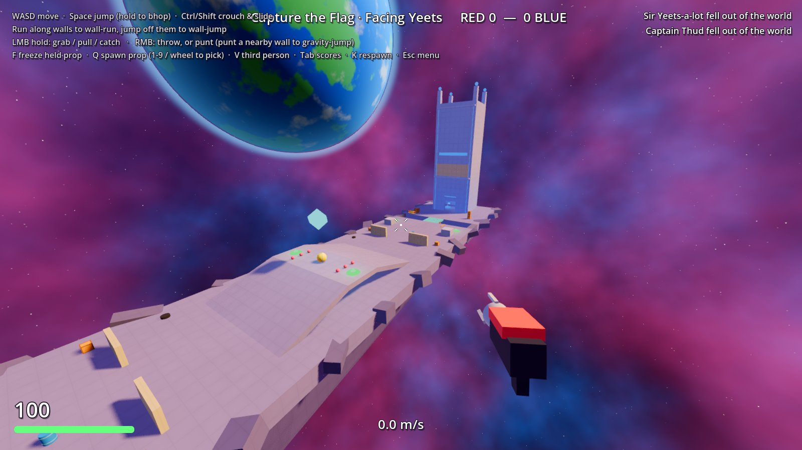

| | |
|---|---|
| 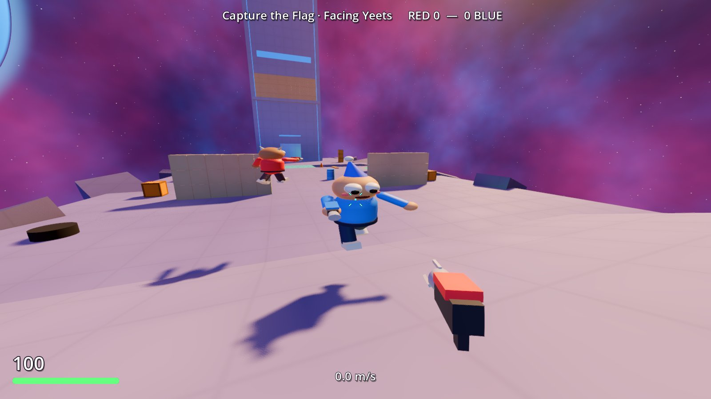 | 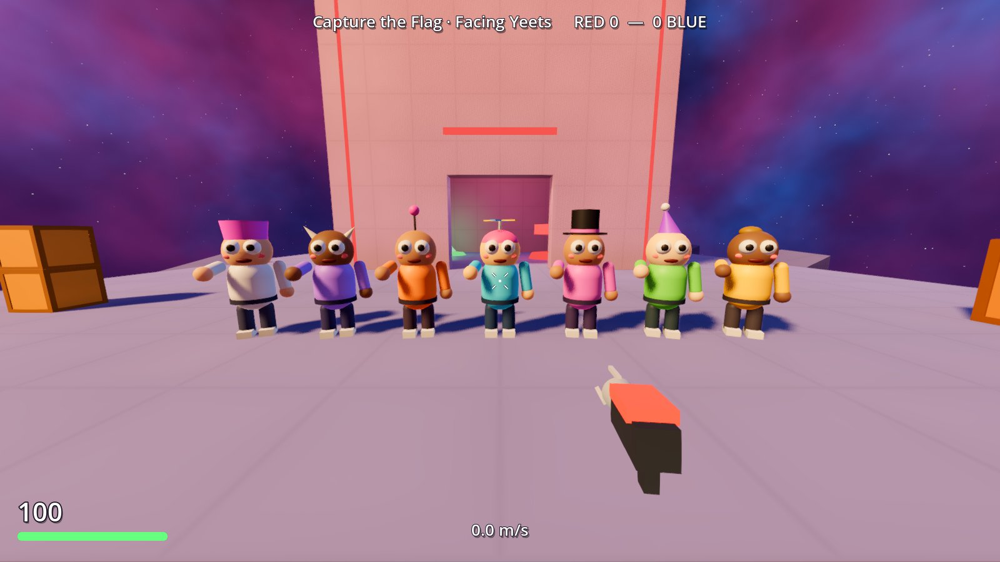 |
| 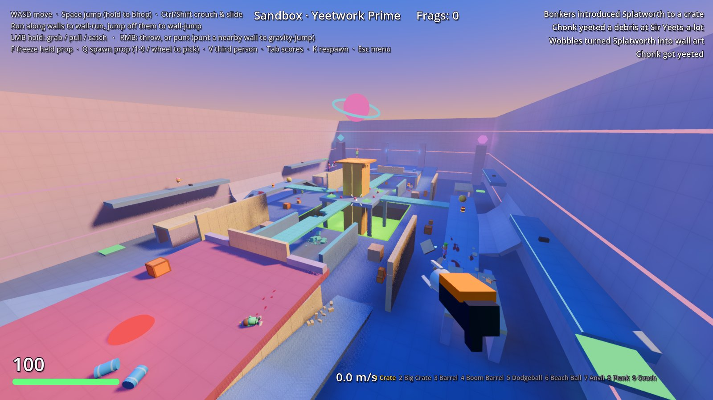 | 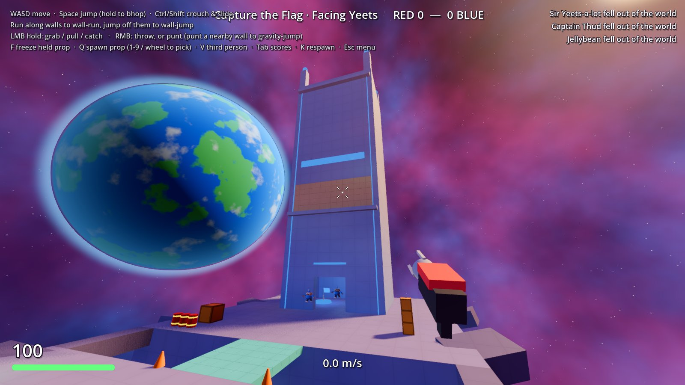 |
| 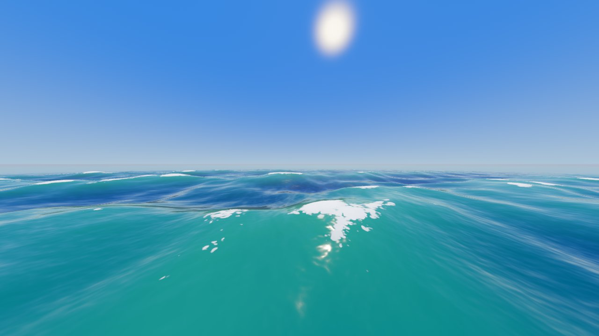 | 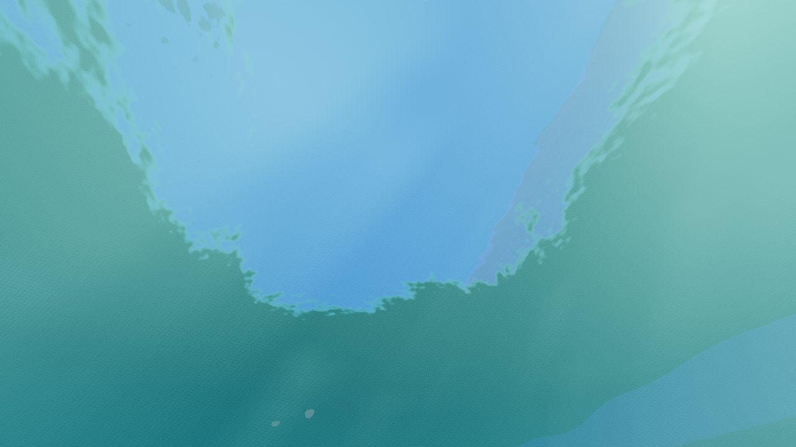 |
| 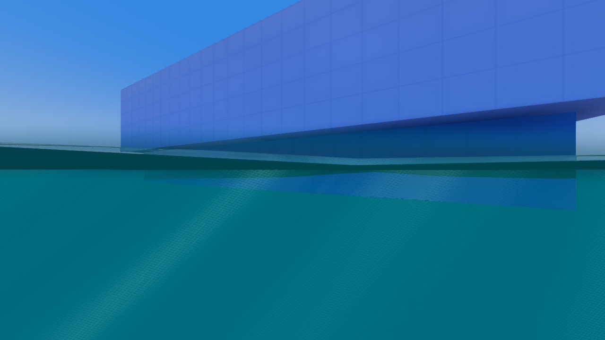 | 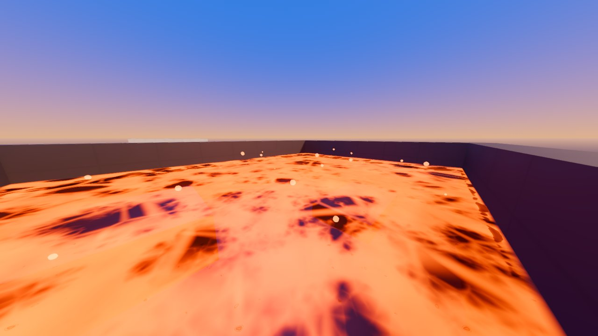 |
| 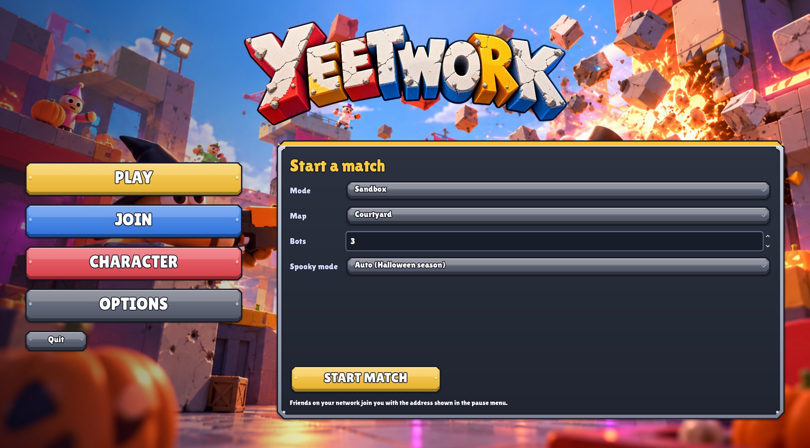 | 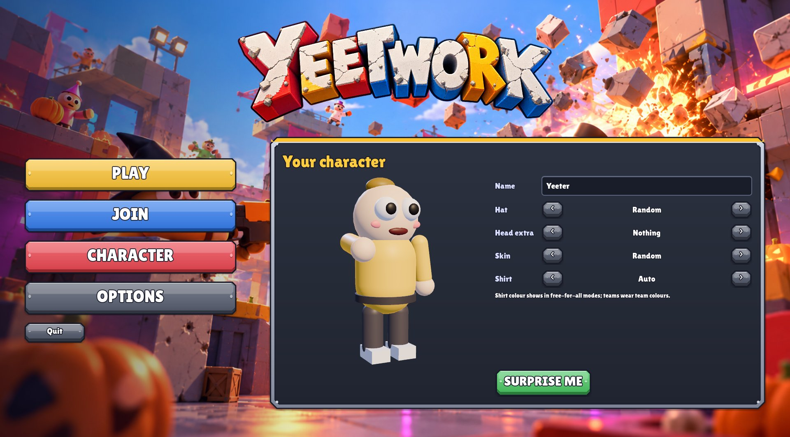 |
| 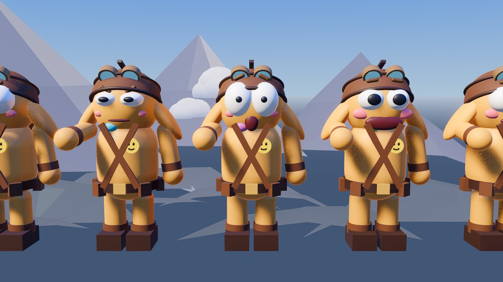 | |

## Downloads: Windows, Linux & Steam Deck

GitHub Actions builds **Windows** and **Linux** versions on every push (see the *Actions*
tab → *Test & Export* → Artifacts). Tagging `v*` publishes a Release. The Linux build
runs natively on the **Steam Deck** with controller support and a Deck graphics preset.
The step-by-step install and multiplayer guide is in **[docs/STEAM_DECK.md](docs/STEAM_DECK.md)**.

## Running

1. Install **Godot 4.7** (standard build, no .NET needed).
2. Open `project.godot` and press **F5** (or run `godot --path .`).
3. In the menu: **PLAY** opens the **match setup**: the mode first, then only the maps that
   suit it (Capture the Flag: maps with two flag stands; Yeetball, YeetHoops, YeetVolley:
   their goals, hoops or net; Puzzle: puzzle levels; the rest any map), then that mode's
   options (bots, pickups; the sports' rules and length; MegaYeet's economy and rules, the
   map's own or custom: the Heart's health, bites, waves, the boss, the breaks) and the world (spooky,
   water, sky); *Start match*. A map played in a mode it isn't made for leaves the other
   pieces out (a deathmatch on a CTF map has no flags; a fortress, no Heart or monsters).
   *Quick start* on the Play page plays the last match again.
   **JOIN** (a friend's address), **CHARACTER** (name, hat, head extra, skin, shirt) and
   **OPTIONS** (display: windowed / borderless / fullscreen, window size, monitor, brightness,
   camera shake, FPS counter; controls, sound and graphics). Friends on your network (or with the port
   forwarded) join with your IP. The default port is `24642` (UDP).
   If your ISP doesn't let you host (CGNAT), run a UDP tunnel such as **playit.gg** pointed
   at local UDP port `24642`; friends paste the address it gives you (`host:port`) into
   **Address** (or `--join host:port`).

Geometry, materials, characters and sounds are generated in code. The only assets are the
menu art and font (`assets/`): the title background and logo, button and frame art made by
`tools/make_ui_art.py`, and the Lilita One font (SIL Open Font License, `assets/fonts/OFL.txt`).

## Controls

| Action | Keys |
|---|---|
| Move | WASD |
| Jump (hold to bunny hop) | Space |
| Swim up / dive (in water) | Hold Space / hold Ctrl. Swim into a ledge holding Space to climb out |
| Run (hold) | Shift. Settings → *Always run* flips it so Shift walks |
| Crouch / slide (slide only while running) | Ctrl or C |
| Gravity gun: grab, pull, catch | Hold left mouse |
| Throw held object (hold to charge) / punt | Right mouse |
| Freeze held prop (sandbox building) | F |
| Grapple hook (hold: hang on and reel in; hold Ctrl to let rope out) | G or middle mouse (gamepad R3) |
| Push / pull held object | Mouse wheel (while holding) |
| Rotate held prop | Hold E + move mouse |
| Use (puzzle buttons, the Reset button; empty hands) | E (gamepad X) |
| Spawn prop (sandbox) / pick prop | Q / 1-9 or mouse wheel (when not holding) |
| Third-person camera | V |
| MegaYeet shop (between waves) | B (gamepad Y; LB / RB switch tabs) |
| Scoreboard | Tab |
| Respawn | K |
| Menu and settings | Esc |
| Fullscreen on / off | F11 or Alt+Enter |

Gamepads work too (sticks, triggers for the gun, A jump, B crouch).

Everything can be rebound in **Options → Controls** (and in the pause menu): one keyboard or
mouse binding and one gamepad binding per action. **Swap mouse buttons** puts the grab on the
right button and the throw on the left. The in-game hints show your own bindings.

## What's in it

**Gravity gun.** A chunky toy sci-fi gun with a glowing core and three claws, modelled in
Blender (`art/gravity_gun/gravity_gun.blend`, built by `tools/make_gravity_gun.py`; its
orange parts take your team colour). Grab, carry, pull, push and throw. Pulled objects lock on and come to
you even if your aim drifts. Holding the trigger catches incoming objects, including
dodgeballs. Push or pull what you hold, and rotate props to line up a build or a shot. You can grab players: teammates for up to 6 s, enemies only briefly, and
throw them across the map. Hold the throw button to **charge** a throw: the object shakes and the crackling
electric arc goes white-hot, and a full charge yeets about 1.8× as hard. Punt everything in a cone (a wave of pushed air rushes out:
faintly tinted in your team's colour, or pale blue-white in free-for-all, bending what's behind it, with
streaks of air shooting ahead). Punt a
wall right in front of you to gravity-jump. Thrown objects inherit your velocity, so moving fast means throwing hard.

**Grapple hook.** Hold G (or the middle mouse button, R3 on a gamepad): it takes hold of the
level and reels you up to it, swinging on the rope; let go to drop. Hook a light prop and
it's yanked over to you; a heavy one and you're reeled in to it; a friend and they're yanked
to you (pull them up a ledge). Puzzle levels let it take hold only on yellow grapple rings
(MapSettings → Grapple), so it can't skip the puzzles.

**Movement.** Quake-style ground and air acceleration (strafe jumping, bunny hopping),
CPM-style air control, crouch slides with slope gravity, wall running, wall jumps,
ramp jumps that keep upward momentum, slope landings that turn falls into speed,
jump pads, lifts, acid that bounces you, gravity jumps, and swimming.

**Water, acid and lava.** Two water styles, picked by the host on the Play page:
*Classic*, and *Sculpted*, which has sharper ridged crests, broad troughs, foam that
stretches with the waves, ripples and foam rings where things hit the water, wakes behind
anything moving through it and churned whitewater after explosions. Sculpted seas come in
calm, lake, ocean and stormy states (`MapSettings → Ocean Preset`).
Liquids have Gerstner waves that roll in irregular sets, foam
where crests fold over and along shores, sun glints, light glowing through thin crests,
refraction with depth absorption (red fades first), caustics, and screen-space
reflections. With your eyes at the surface the view splits above and below the
waterline. Underwater there is fog, light shafts, caustics dancing over the floor and walls, Snell's
window, a gentle wobble and colour fringe on the view (not the HUD), and sound is muffled.
In pools and flood water you float with your head out (deep enough, the water lifts you off
the bottom; hold crouch to stay down there), hold jump to swim up and crouch to dive. Wood,
rubber and soft props float and bob on the waves; metal and stone sink. Big splashes
hit everyone's screen. The open ocean around a map is too rough to swim in: fall in and
you sink and drown ("sleeps with the fishes"). Acid and lava bounce and burn you, and lava
has drifting plates of cooled crust.

**Fire.** Explosions set wooden things alight (crates, barrels, planks, couches, boards),
and so do burning places (Lagoon has a bonfire). Fire is drawn as soft, glowing cartoon
flames: one metaball mass hugging the burning thing, see-through in the middle with a
bright edge, rounded tongues that stretch, curl and pinch off droplets, plus a glowing shell,
smoke, light and crackle. Burning things hurt players next to them and spread to their
neighbours; wood burns down into smouldering boards (anything that has burned out stays burnt and won't light again); a burning boom barrel cooks off.
Players on fire take damage for a few seconds unless they jump into water.

**Weather.** Rain is reusable on any map (`MapSettings → Weather`); the storm adds wind
wisps, lightning and thunder.

**Player physics.** Players are physics objects: they get launched, held, thrown and
knocked down (tumbling ragdoll state). Thrown players smash through breakable walls,
bowl over other players (the thrower gets the credit) and splat against scenery. Death
spawns a full joint-based ragdoll corpse.

**Destruction.** Every breakable slab (walls, bridges, tunnel roofs, windows) is cut into a
seeded irregular Voronoi pattern of cells with noisy, jagged outlines. When cells break,
the slab mesh and collision are rebuilt, so holes are real geometry you can fly through.
- **Impacts leave different damage.** Fast small objects punch small holes ringed by
  cracks. Heavy props tear holes that scale with their size and mass. A launched player
  leaves a person-sized hole. Explosions make craters.
- **Damage accumulates.** Surviving cells near a hit show cracks, chips and dents, and
  repeated hits enlarge holes.
- **Fragments.** Broken cells shatter into impact-biased fragments. Big fragments become
  physical objects for everyone: grab them, throw them, break other walls with them.
  Fragments thrown hard enough split again. Small splinters are local effects that fade.
- **Gradual collapse.** Small unsupported pieces drop as one chunk. Large unsupported
  sections creak, strain and crumble from the hole edges inward before falling.
- **Materials.** Plaster, concrete, brick (brick-shaped chunks), wood (plank-like splinters
  along the grain), glass (many shards, used for windows) and metal (very tough) each
  break differently and sound different.
- **Props shatter too.** Crates burst into plank boards, barrels into staves and lids,
  planks snap in two, and explosive barrels throw metal shrapnel. Gravestones and coffins
  break into fragments of their own shape. The biggest pieces stay grabbable.
- Explosive barrels chain-react.

**Impacts you can feel.** Sounds are synthesized in layers (transient, material body, and a
sub-bass thud for heavy hits) with several variants each, and they scale with impact
energy. They play through a compressor and light reverb. Hits also produce dust rings,
sparks (metal), splinters (wood), grit (stone), impact flashes, camera shake and FOV
punches.

**Blood and gore.** Directional splatter particles and persistent decals sprayed along
the impact direction. The intensity setting has three levels: *Off* (confetti instead),
*Silly* and *EXTREME* (more of everything, plus giblets).

**Modes.**
- **Sandbox**: free-for-all. Spawn props (Q) and freeze them in place (F) to build
  obstacle courses, ramps and contraptions.
- **Capture the Flag**: the flag is a physics prop. Carry it with the gravity gun, throw
  it, or launch a teammate who is holding it. Touch your own dropped flag to return it.
- **Dodgeball**: a live ball (thrown, not yet bounced) knocks out an enemy. Catching an
  enemy's live ball knocks out the thrower.

- **Pumpkin Smash** (Halloween): free-for-all candy grab. Smash jack-o'-lanterns
  (golden ones are worth more) to spill candy, then walk over candy to collect it. Getting
  killed spills everything you carry, so yeet the leader. First to 40 wins the round.
- **Puzzle (co-op)** (first step, see [the proposal](docs/design/PUZZLE_COOP.md)): no
  bots, no frags. Get through a puzzle level together: pressure plates that need a crate,
  an anvil or a friend; gates that open from them; checkpoints you respawn at; an exit that
  finishes the level when everyone's in it. Friends can't hurt each other. The top of the
  screen shows the clock and the current objective. Targets, buttons, timed and ordered
  logic, smashed walls as switches; props a puzzle needs come back when lost, and a big
  red Reset button (press E) tidies a room. Seesaws that yeet you, turntables, and a big fan
  you can grab and aim. Ice, solid or breakable: Yeets skate on it, crates glide. At the exit
  everyone gets the results: the time and its medal, stats (props destroyed, times a friend
  yeeted you, deaths, the longest throw) and awards for how it went (Big Brain Yeet,
  Structural Disagreement, Unscheduled Flight, Task Failed Successfully, Certified Yeet
  Engineer). Lost Yeets to rescue: carry them (screaming) to a rescue mat with the gun.
  Fuse boxes that want their fuses. Levels:
  **Moving Day** (five rooms, up to loading the van and a Lost Yeet stuck on the wardrobe),
  **Test Chambers** (Heavy Decisions, The Impossible Shot, Three Idiots One Door, Yeetapult,
  Windy Business, Thin Ice, Structural Engineering (Gone Wrong), Hot Potato, Pass the Yeet),
  **The Warehouse**, an open level: three
  fuses for the main gate, one in each wing, and a Lost Yeet in a cage; split up, any order,
  **The Pump House** (with machines humming, pumping and steaming: Map Kit Fixtures): flood
  water that fills rooms, floats crates and drains away, and
  fire that spreads from beacon to beacon, burns wooden walls down, runs along fuses and
  melts ice, and **The Scrapyard**: grapple ring to ring over a chasm, ride a counterweight
  lift, work a magnet crane (a battery powers it), close a circuit (metal, water, or a
  brave Yeet who gets zapped), burn through the rope an anvil hangs on.

**Yeetball** (sports). Football with gravity guns: two teams, one big glowing ball, two
goals. Punt it, throw it, pass it, catch it, bank it off the walls; the whole ball over the
line is a goal ("GOOOOOOOYEET!"). Kickoff after a countdown (the whistle) with everyone in
their own half; the gun holds the ball a moment at most (no carrying it into the net); the
ball never hurts anyone. Lost balls, and balls lying still too long or with nobody near,
come back to the middle; standing in your own net for more than 5 s gets you bounced out.
- **Match length** (menu): 3, 5, 8 or 10 minutes, or *first to 5 goals*. The clock runs
  only while the ball is in play; the team ahead at full time wins, five goals win early,
  and level at full time it's **golden goal** (the next goal wins). Then a **full-time
  screen** for everyone (the score, who scored, player of the match, the longest goal):
  the host picks *Next match* or *Back to menu*.
- **Rules** (menu): *Classic Chaos* (recognisable football, 2.5 s holds) or **TOTAL YEET**:
  4 s holds, a faster ball that bowls people over, **multi-ball** now and then, and
  exploding barrels falling near the ball.
- **Ball hits players** (menu): *a harmless bonk*, or *knocks them over* (a short tumble,
  never any damage; always on in TOTAL YEET).
- A commentator who gets far too excited (long-range screamers, goals straight from the
  kickoff, last-second winners, hat-tricks, own goals), a crowd that goes wild, and a
  player of the match.
- The ball is easy to follow: arrows at the screen edge point to it when it's out of view,
  a marker picks it out when it's far off, and a ring on the ground shows where it'll land.
- Bots play too (the nearest chases the nearest ball and punts it at the goal, the others
  hang back). Map: **Yeetball Stadium**.

**YeetHoops** (sports). Basketball with gravity guns, on Yeetball's rules (tip-off, clock,
next basket wins, rulesets, ball knockdown, full-time screen): two hoops, a small bouncy
basketball that's thrown gently enough to lob (charge for distance). A basket is the ball
dropping down through the rim: **2 points**, **3** from beyond the glowing arc, and a
**dunk** (carried in on the gun) is 2 and a show. First to 21 wins early. Backboards are
solid for bank shots; jump pads on the wings send you up to the rim. The commentator calls
swishes, threes, dunks, buzzer beaters and players on fire. Bots pull the ball in with the
gun, set their feet and lob it in on an arc they work out the way the physics flies it;
the others crash the boards or go and punt whoever has the ball. Map: **Hoops Court**.

**YeetVolley** (sports). Volleyball with gravity guns, on the same sports rules: keep the
big, floaty volleyball off your side's sand and send it over the net. The ball touching the
floor in a half is a point for the other team; out of the lines (or in the sea) is a point
against whoever touched it last. Rally scoring: whoever wins the point serves, the serve
floating in over the back of their half. First to 15. **Classic**: three touches a side,
brief catches (1 s), the gun only reaches the ball on your own side, everyone stays on
their side of the net. **TOTAL YEET**: unlimited touches, grab it anywhere, 2 s catches,
multi-ball, barrels, and the net climbs with every point. Aces, spikes, long rallies and
outs get the commentator going. Bots read where the ball will come down, the nearest gets
under it, catches it and lobs it deep into the other half; the rest spread over their half.
Map: **Volley Beach**.

**MegaYeet (co-op)** (a first playable step). Endless waves of monsters come for the
fortress and everyone defends it together, bots included; friends can't hurt each other.
The **Fortress meter** at the top is the team's life: every monster inside the fortress
drains it each second, more the deeper it gets (the outer walls, the courtyard, the keep),
and one that reaches the glowing **Heart** in the middle takes a big bite. Kills put points
back, more for style (thrown off a wall, crushed by a crate, drowned, into lava, bowled over
by a flying friend), and a burst of kills is a combo (TRIPLE SPLAT, MONSTER MASH,
MEGAYEET). Holding a wave tops the meter up; there's a short break before the next, bigger
one, and the break is for shopping. **B** (Y on a pad) opens the **shop window**: tabs of
cards with turning pictures and prices: **traps** (spikes that hurt and slow, a fire grate
that sets them alight, a mine that blows up under them: built on the free spot of that kind
nearest you), **power-ups** for yourself (first aid, speed, feather, Super Yeet, Iron Yeet:
they last 45 s into the wave), **team upgrades** (stronger pushes and throws for everyone,
softer bites, quicker respawns, in that order), **repairs** (the nearest broken gate, or all
of them) and, with personal Y$, **the Heart** (heal it, dearly). Use works too: on a broken
gate, a trap spot, the Heart. What pays is the match's **Economy**: *Shared* (the default:
the Fortress meter is money as well as life, and a tenth of it is never spent) or *Personal
Y$* (every Yeet earns their own Y$, shown by the meter: 5 a kill, 5 more for style, the
combos, 30 and more for every wave held, 150 for bringing the boss down and 75 for everyone
else; the meter is only life then, and kills put nothing back in it). The **iron ball** is too heavy for one gun: grab it alone and it only strains
toward you ("1 of 2 pulling"); with two guns on it, it lifts and floats where you aim
together, and either of you charges and throws it along your shared aim (harder with more
of you): it flattens whatever it hits, brutes included. The Fortress has two. Every fifth
wave is a **boss wave**: **the Siege Golem**, three times a Yeet's height, leads it in (its
health bar on the HUD). Gates crumble under it; pushes, grabs, falls and water do nothing; it
stomps anyone close (and flattens its own minions), hurls boulders at Yeets up on the walls
(catch one and throw it back), and calls packs out of the ground. Blasts, fire and heavy
things hurt it, the iron ball most of all; bringing it down tops the meter up (or pays Y$). Monsters walk the ways to the Heart, batter gates down and hit any Yeet they reach; a
gravity-gun push and blasts send them flying, flung props crush them, they die from falls,
lava, acid and deep water, and fire spreads through a crowd. Grab one with the gun and
throw it, or swing it into the others. Waves mix the kinds as they go on, each announced
the first time: **shamblers** (the many), **runners** (fast, fragile), **bombers** (they
run at gates and Yeets with a powder keg; killed, they go off where they fall), **brutes**
(Frankenstein's monster: too heavy to grab, a push barely moves one, smashes gates and
Yeets; blast, burn, drop or drown it), **climbers** (skeletons: straight at the Heart, up
and over the walls) and **ghosts** (through walls; only fire and light hurt them, and in
MegaYeet everyone carries a flashlight). At zero the fortress falls:
how many waves you held, then everything starts again (walls rebuilt). Hundreds at once
stay cheap (they aren't physics bodies; drawn in one batch). Bots find their way round the fortress
(hopping walls, riding jump pads) to the monsters they can reach. A map's FortressHeart
sets the rules (the meter's size, bites, refills, breaks, wave sizes); gates are as tough
as their map says. Map: **The Fortress**; any
other map works too (the game puts a Heart amid its spawns, zones round it and rifts far
out).

**Pickups and power-ups.** Maps have first aid kits (+50, or +100 for the big one) and
power-ups floating over glowing pads; walk through one to take it, and it comes back after
a while. **Speed** (40% faster, 12 s), **Super Yeet** (throws, punts and launches 1.8x
stronger, 15 s), **Feather** (low gravity, high jumps, 12 s) and **Iron Yeet** (can't be
grabbed, barely knocked about, half damage, 12 s). Each boost shows above your health with
a countdown, and has its own screen effect (speed lines, an orange glow, a cyan haze, a
steel rim); its last 5 seconds tick quietly. Dying ends them. *Pickups* in the menu: first
aid and power-ups, first aid only, or none. Maps place them with **PickupSpawn**.

**Dark maps and storms.** The **haunted** sky is truly dark and misty: a faint moon, low
haze that lamps glow in, bats overhead. Light it with **MapLight** pieces (bulbs, lamp
posts, wall lamps, candles, torches, spotlights, neon), which can flicker (candle, faulty,
strobe, pulse), cast shadows and be wired to switches. Under a dark sky every Yeet carries a
flashlight (yours casts shadows; you see everyone else's beam), switched on and off with
**L** (D-pad left), and everyone sees it go dark. Lights **break**: a crate flung into a lamp,
a blast, a push from the gravity gun or lightning smashes it (a candle or a torch is blown
out), and it flickers back on after a while. Example map: **Haunted Yard** (a graveyard with
a crypt; find the power switch). **Storms** (the `storm` sky or weather) strike real
lightning: branching bolts from the clouds to the ground that light up the land, sheet
lightning in the clouds, and thunder as late as sound would arrive, a crack first when it's
close. Every half a minute or so lightning **strikes the map itself**, mostly something tall
(a lamp post, a crate up high): it catches fire, Yeets next to it are zapped and thrown, and
the lights around it break.

**Fire look.** Burning things char dark in crisp patches, split by sharp glowing ember cracks
(3D Voronoi cell borders in world space: no seams across faces), with the odd cell glowing as
a hot ember and hard-edged licks of flame crawling up their faces; bold flames with real depth wrap
round their sides and rise over the top, tearing into licking tongues (ray-marched through
rising 3D noise in a box over the burning thing: a hot core glowing past white (HDR), orange,
red at the edges, dark smoky tips fading out; the thing hides the flames behind it, and a burning player doesn't see their
own; 28 / 20 / 12 steps on High / Medium / Low), and embers drift up. Burning props and
doors wobble like a cartoon while they burn (squash and stretch from their foot, a jiggling
lean; their meshes only, not their collision). *Graphics details →
Fire look → Classic* brings back the soft flame mass and smoke.

**Map themes.** A **MapTheme** gives a map's pieces and props their look in one file: a
model for each kind of piece (jump pads, buttons, valves, doors, goals, hoops, pickups...)
and each prop (crates, barrels, couches...), picked in MapSettings. Only the look changes,
so gameplay stays the same; moving parts come from the model by name (a button's `Cap`, a
valve's `Wheel`...). Every piece also has a Model slot of its own, which wins over the theme.
See [docs/MAPPING.md](docs/MAPPING.md), "Themes".

**Spooky mode.** During Halloween season (Oct 15 - Nov 3), when set to *Always* in the
menu, or in Pumpkin Smash, every map gets:
- Purple dusk lighting with an orange horizon, a big moon, thick fog and circling bats.
- Glowing jack-o'-lanterns that burst into goo and candy.
- Gravestones and coffins that shatter into stone and wood fragments.
- Pumpkin-head and witch costumes, spooky bot names and howling wind.

**Maps.**
- **Facing Yeets**: inspired by UT's *Facing Worlds*. A long asteroid strip in space
  with two team towers. Launch shafts lead to a sniper floor with a breakable window
  and to the roof (which has anvils for dropping on people). There is a central hill
  and breakable bridges over chasms. Falling off is death.
- **The Fortress** (MegaYeet): three rings of walls round the Heart, wooden gates in the
  outer two and metal ones in the low keep wall (hop over it; monsters can't), jump pads up
  onto the walls, blast barrels up there to drop on them, six rifts outside.
- **Courtyard**: the Map Kit example map, an island in the sea. Team decks, a breakable
  gate, an acid trench with a wooden bridge, a catwalk with a lift and an updraft.
- **High Seas**: the container ship MV *Bad Decisions* on the open ocean. The whole ship
  rolls, pitches and heaves on the ocean's long swell (gently in calm seas, up to about 13°
  in a storm), the same for every player. Loose cargo starts to move as the deck tilts:
  balls and barrels on their side first, crates in rough seas, anvils hardly ever. Red
  spawns on the bow, Blue at the bridge. Falling overboard isn't the end: swim to one of the
  yellow ladders on the hull and climb back aboard (bots do too). Climb a ladder through the
  hatch in a bridge wing into the **bridge**: big breakable windows over the cargo, and the
  **ship's horn** on the console (Use to sound it). Container stacks with aisles, ramps and
  pads, and **lashing bridges** between the bays (ladders up from the side walkways). Ladders:
  forward climbs, back goes down, let go to hang on. **Cargo**: some top containers are lashed
  down with yellow rods that can give: a blast, a gravity-gun push, lightning or a storm's
  rolling works them loose (they creak first), and the container breaks free, 900 kg sliding
  across the tilting deck (too heavy to grab, deadly when it drops on you) and maybe over the
  side, where it floats. A few containers stand open on deck as hideouts, some with a power-up
  inside. Cargo that drifts far off comes back. Down the two hatches by Blue's base is the
  **engine room**: the main engine thumping (it shakes the room), generators, pumps, fans,
  steam pipes (one leak scalds), a radio left on, and a switchboard that zaps whoever leans
  on it; anything flung hard enough breaks a machine for a while. It stays dry however far
  she heels. Forward, a **deck crane** sweeps its swinging container over the stacks: ride
  it, or get swept off the tops by it.
  Four variants: **High Seas** (open ocean, tropical sky), **Golden Hour** (calm sea at
  sunset), **Storm** (a knife-edged, confused stormy sea whose wave trains cross from wide
  angles, streaks of blown foam, spray off the crests and the hull, rain, wind wisps, low
  storm clouds, lightning and thunder) and **Hurricane** (wilder still: she rolls up to 20
  degrees). In a storm or a hurricane **green water** comes over the low side when she rolls
  hard and runs across the deck, shoving whoever's there (into the stacks, or over the far
  rail) and putting out fires; every few minutes a **rogue wave**: a warning, the ship's horn,
  a wall of water rising out of the sea, then it breaks over the whole deck, she lurches, Yeets
  are knocked flying and lashings give. Decks are **wet** in rain and after green water:
  less grip for Yeets and cargo.
- **Lagoon**: a ring island around a swimmable lagoon out at sea. Dive off the tower,
  float the junk, fight over the breakable piers to the glass-fronted team bases. The
  place to see both water styles.
- **Yeetwork Prime**: a vertical 90s arena. An acid pit sits around a central tower,
  with breakable bridges to each base, side lanes with wall-run walls, tunnels,
  catwalks with lifts, and quarter pipes for slope boosting.

**Bots.** They grab junk, chase people, lob things at them, punt anyone close, bunny hop,
play CTF and dodgeball, and regularly fall off the map. *Bot skill* in settings (host)
picks Easy, Normal (default) or Hard. Hard is the original sharpshooter.

**Glass.** Windows refract what is behind them (with a touch of colour dispersion), tint
more at grazing angles, reflect the world and the sky, and show white cracks as they take
damage.

**Graphics options.** Low (Steam Deck), Medium and High presets, plus every detail on its
own: resolution, upscaler (FSR 1 / FSR 2), anti-aliasing, shadows, lighting (SSIL, SDFGI),
ambient occlusion, volumetric fog, bloom, water quality, glass quality, explosions, clouds,
character models (*Optimised* or the *Original* build), VSync and a frame rate cap.
Available in the menu and in the pause menu. Sun shadows are soft and clean (a finely
filtered blur); with TAA or FSR 2 they also harden where things touch the ground (PCSS,
which is grainy without a temporal pass to smooth it).

**Effects.** Dust, smoke, mist and whitewater are dense cauliflower puffs: clusters of
round lobes, each lit like a little sphere (warm tops, cool undersides), coloured by a
gradient over their life and fading softly into the ground (dust kicks up on landings, runs
and slides). Explosions burst into a cauliflower mushroom (cap, stem and a ring of fire
along the ground) that brakes hard, then rises and fades from white-hot through orange
and ember red to grey smoke, while rock chunks and ember streaks fly out; on Medium/High a
ray-marched volumetric fire core burns inside. The gravity gun's arc is branching lightning
with a soft blue glow and starbursts at both ends; charging a throw draws swirling motes
and crackling arcs into the muzzle, and thrown things leave a short glowing energy trail. Coming out of
the water leaves drops on the lens: beads that refract and disperse the light, and teardrop
runners that slide down leaving wet trails.

**Environments.** Each map picks one (*MapSettings → Sky*), and the host can override it
on the Play page: sunset, day, tropical (islands), desert (mesas, dunes), snow (peaks and
pine forests), volcano (a glowing volcano under a red sky), night and space. Each has its
own sky, light, haze, low-poly scenery on the horizon (storm: open sea, lightning) and puffy cartoon clouds drifting
overhead (*Clouds* option).

**Look.** Stylized PBR with a custom triplanar surface shader (soft panels, warm-to-cool
height gradients), a warm key sun, cool fill light, SDFGI and SSIL bounce lighting, soft
SSAO, AgX tonemapping, subsurface-scattered skin and a custom space sky. There is no
cel shading and there are no outlines.

## Making maps

Arenas are built in the Godot editor with the **Map Kit**: drop-in nodes for blocks,
breakable slabs, spawns, flags, props, jump pads, lifts, hazards and lighting presets.
Save a scene in `res://maps/` and it appears in the map list. Press **F6** on it to
playtest with bots. The full guide is in **[docs/MAPPING.md](docs/MAPPING.md)**, and
`maps/courtyard.tscn` is a complete example. The built-in Yeetwork Prime and Facing Yeets
are Map Kit scenes too (`maps/prime.tscn`, `maps/facing.tscn`), so you can tweak them in
the editor.

**Custom maps (map packs).** Maps can also live outside the game: make one in
`custom/<your_map>/` with its own textures (PBR materials on blocks), models (as scenery or as
the look of jump pads, lifts, doors, buttons and plates) and scripts, export it with
`tools/export_map_pack.bat <your_map>` and put the `.zip` in a `maps` folder next to the game.
It shows up in the map list as *(custom)*. Packs with scripts of their own load only after
the player allows them (Play page); a player who joins without the server's map pack is told
which one to get. Your first custom map, step by step with pictures:
**[docs/CUSTOM_MAPS_GUIDE.md](docs/CUSTOM_MAPS_GUIDE.md)** (the short version: `custom/README.md`).
**Your own versions** of game objects, next to the built-in ones and without code: a new
pipe (its model says where the water comes out), a new trap (its own model, name, damage,
slowing; the shop sells it), a new crate or barrel (a PropType: your model, size, weight,
toughness); `custom/make_your_own/` has one of each, starter models with their markers, and
a map using them all (*Make Your Own Workshop*).

```bash
godot --headless --path . -- --map courtyard --validate
```

## Networking

Listen-server ENet via Godot's high-level multiplayer. The server simulates props,
destruction, damage, gravity guns and scoring. Each client simulates its own player
(responsive movement) and streams its state; everything else is interpolated. All RPCs
live on `World` (`scripts/core/world.gd`). Late joiners receive a full snapshot, including
which wall cells are already broken.

## Code map

```
scripts/core/     game.gd (settings, input map), main.gd (menu/session), world.gd (match + network hub)
scripts/player/   player.gd (movement), gravity_gun.gd, character_model.gd, ragdoll.gd
scripts/props/    prop.gd (networked physics objects)
scripts/world/    arena.gd (+ Prime layout), map_facing.gd, destructible.gd, mats.gd,
                  world_surface.gdshader, space_sky.gdshader, trigger_volume.gd, lift.gd,
                  liquid.gd + liquid.gdshader + liquid_waves.gdshaderinc (water, acid, lava),
                  liquid_sculpted.gdshader + liquid_waves_sculpted.gdshaderinc (sculpted water),
                  underwater*.gdshader (full-screen underwater pass), glass.gdshader,
                  ssr.gdshaderinc (screen-space reflections for water and glass),
                  map_high_seas.gd + ship.gd + container.gdshader (High Seas), ship_crane.gd
scripts/mapkit/   the Map Kit's pieces (fixture.gd: set dressing that hums, turns, breaks)
scripts/modes/    mode_base.gd (sandbox), mode_ctf.gd, mode_dodgeball.gd, mode_megayeet.gd...
scripts/horde/    horde.gd (MegaYeet's monsters: server walkers, snapshots, one MultiMesh),
                  flow_field.gd (the ways to the Heart), monster_look.gd + monster.gdshader
scripts/fx/       effects.gd (blood, decals, explosions, debris), sfx.gd (synthesized sounds),
                  ambience.gd (the fixtures' looping hums), yeetish.gd (the Yeets' voices),
                  music.gd (assets/music/ tracks by name, the Music bus)
scripts/bots/     bot_brain.gd, bot_field.gd (MegaYeet: one shared map for every bot to the monsters)
scripts/ui/       hud.gd, main_menu.gd, settings_form.gd, ui_theme.gd, character_preview.gd
tests/            test_runner.gd (gameplay smoke tests)
tools/            make_ui_art.py (menu button/frame art), glb_to_blend.py (characters .blend),
                  make_gravity_gun.py (the gun model: .blend and assets/models/gravity_gun.glb)
art/              source art for Blender (ignored by Godot)
```

## Development

Command-line options (after `--`):

```bash
# Host directly: mode, map and bot count
godot --path . -- --host --mode ctf --map facing --bots 6 --bot-skill 1
# Yeetball with TOTAL YEET rules and a 3-minute clock (--rules classic|total, --minutes 0 = first to 5,
# --knockdown on|off: the ball knocks players over). --pickups all|health|none in any mode.
godot --path . -- --host --mode yeetball --map yeetball_stadium --bots 5 --rules total --minutes 3

# Join a server
godot --path . -- --join 192.168.1.20

# Gameplay smoke tests (movement, gun, destruction, explosions, CTF...)
godot --headless --path . -- --host --map prime --mode ctf --bots 0 --test

# Puzzle mode: a level played through by a script (checks every step; screenshots without --headless)
godot --headless --path . -- --host --map moving_day --mode puzzle --tour x --tour-mode puzzle
godot --headless --path . -- --host --map test_chambers --mode puzzle --tour x --tour-mode puzzle
godot --headless --path . -- --host --map warehouse --mode puzzle --tour x --tour-mode puzzle
godot --headless --path . -- --host --map pump_house --mode puzzle --tour x --tour-mode puzzle
godot --headless --path . -- --host --map scrapyard --mode puzzle --tour x --tour-mode puzzle

# Dark maps: lights wired to a switch, flashlights (and their switch), a failing lamp, a lamp
# smashed by a crate that comes back on (haunted_yard); and a storm's lightning (a bolt, its
# light, the thunder; a strike on the map zapping a Yeet and setting a crate alight)
godot --headless --path . -- --host --map haunted_yard --mode sandbox --bots 2 --tour x --tour-mode dark
godot --headless --path . -- --host --map lagoon --sky storm --mode sandbox --bots 0 --tour x --tour-mode dark

# Map themes: the example garden's theme on its pieces and props, own models first,
# built-in looks hidden, named moving parts, themed pickups
godot --headless --path . -- --host --map res://custom/example_garden/example_garden.tscn --mode sandbox --bots 0 --tour x --tour-mode themes

# Pickups: first aid heals and comes back, every power-up measured on a bot, the HUD,
# a hurt bot fetching first aid, the host's "no pickups" setting
godot --headless --path . -- --host --map prime --bots 2 --tour x --tour-mode pickups

# YeetVolley: the serve, landing in a half, out, four touches, the gun on your side only,
# staying on your side, the sea, the net rising, bots rallying, full time at 15
godot --headless --path . -- --host --map volley_beach --mode volley --bots 3 --tour x --tour-mode volley

# YeetHoops: 2 and 3 points, no basket from below, a solid backboard, a dunk, bots shooting
# (and a lone bot scoring), full time at 21
godot --headless --path . -- --host --map hoops_court --mode hoops --bots 3 --tour x --tour-mode hoops

# Yeetball: kickoff, goals, the hold limit, a lost ball, bots playing, full time, the
# clock and golden goal, no camping, TOTAL YEET's multi-ball and barrels
godot --headless --path . -- --host --map yeetball_stadium --mode yeetball --bots 3 --tour x --tour-mode yeetball

# Headless soak test: quit after N seconds and print a summary
godot --headless --path . -- --host --bots 8 --autotest 60

# Save screenshots from fixed viewpoints, or a scripted destruction showcase
godot --path . -- --host --map facing --bots 6 --tour /tmp/shots
godot --path . -- --host --map prime --bots 0 --tour /tmp/shots --tour-mode destruction

# Liquids: sea, waterline, underwater, splash (Courtyard); acid, pool and lava basins (Prime).
# --shots "name:ex,ey,ez:tx,ty,tz;..." takes custom views, --perf prints GPU time per view.
godot --path . -- --host --map courtyard --bots 0 --tour /tmp/shots --tour-mode water

# Any of these with a graphics preset for one run (0 = Low / Steam Deck, 1 = Medium, 2 = High)
godot --path . -- --host --map courtyard --graphics 0

# Water style, sea state and environment for a match (the host's choice reaches every client)
godot --path . -- --host --map courtyard --water-style sculpted --sea stormy --sky volcano

# High Seas: how far the ship rolls and pitches, and whether players and cargo stay aboard
godot --headless --path . -- --host --map highseas --bots 0 --tour x --tour-mode ship --sea stormy
# High Seas routes: overboard and back up a ladder (a bot too), into the bridge, its horn
# and windows, up onto a lashing bridge, the engine room (down a hatch, dry, the switchboard)
godot --headless --path . -- --host --map highseas --bots 1 --tour x --tour-mode shiproutes
# High Seas cargo: lashed containers break loose (a blast, a storm), open containers, floating,
# the deck crane (it slews, ride its load, it sweeps you off)
godot --headless --path . -- --host --map highseas --bots 0 --tour x --tour-mode shipcargo
# High Seas weather: a hurricane's roll and washes; a wash, a rogue wave, a wet deck (calm sea)
godot --headless --path . -- --host --map highseas_extreme --bots 1 --tour x --tour-mode shipweather
godot --headless --path . -- --host --map highseas_dusk --bots 1 --tour x --tour-mode shipweather
# The match setup's rules: which maps suit which modes, the host's MegaYeet rules, unused
# pieces left out (the Fortress as a deathmatch)
godot --headless --path . -- --host --map res://maps/fortress.tscn --bots 0 --tour x --tour-mode setup
# MegaYeet: waves, the ways to the Heart, a gate battered down, the meter, kills, bots, the
# time 200 monsters take a tick, the fall and a fresh start, the shop window and personal Y$
# (screenshots with a folder)
godot --path . -- --host --map res://maps/fortress.tscn --mode megayeet --bots 3 --tour /tmp/shots --tour-mode megayeet
# Make your own versions: a pipe pouring from its model's Spout, a drain's Intake, oil drums
# (a PropType), a thorn bed trap of your own in the shop and at work (the Workshop map)
godot --path . -- --host --map res://custom/make_your_own/workshop.tscn --mode megayeet --bots 0 --tour /tmp/shots --tour-mode makeyourown
# ... and over the network: a client sees the oil drums and the thorn bed as they are
godot --headless --path . -- --host --map res://custom/make_your_own/workshop.tscn --bots 0 --port 24812
godot --headless --path . -- --join 127.0.0.1 --port 24812 --tour x --tour-mode makeyourownclient
# ... the shop window, every tab (screenshots at 1600 x 900 and the Steam Deck's 1280 x 800)
godot --path . -- --host --map res://maps/fortress.tscn --mode megayeet --bots 0 --tour /tmp/shots --tour-mode shop
# ... with a full house of bots (11) and a big wave: how long the server's frames take
godot --headless --path . -- --host --map res://maps/fortress.tscn --mode megayeet --bots 11 --tour x --tour-mode megayeetbots
# ... and over the network: a client joining a MegaYeet host sees the monsters and the meter,
# and buys a power-up in the shop
godot --headless --path . -- --host --map res://maps/fortress.tscn --mode megayeet --bots 2 --port 24781
godot --headless --path . -- --join 127.0.0.1 --port 24781 --tour x --tour-mode megayeetclient
# Fixtures: the Pump House's machines run, the wired pump waits, breaking and mending, a zap
godot --path . -- --host --map pump_house --mode puzzle --bots 0 --tour /tmp/shots --tour-mode fixtures

# Effects in front of a still camera (explosion, dust, gun arc, lens drops), and a cracked window
godot --path . -- --host --map lagoon --bots 0 --tour /tmp/shots --tour-mode fx
godot --path . -- --host --map prime --bots 0 --tour /tmp/shots --tour-mode glass

# Every hat and head extra in a line-up; the menu on a given page; the pause menu
godot --path . -- --host --map prime --bots 0 --tour /tmp/shots --tour-mode looks
godot --path . -- --menu-page character --screenshot /tmp/menu.png
godot --path . -- --host --paused --screenshot /tmp/pause.png
```

## Characters

Characters are built in code in a toy-like style in the spirit of Kenney's characters: big
heads, googly eyes, stubby limbs, procedural animation and a joint-based ragdoll
(`scripts/player/character_model.gd`).

**Kept light.** Each round shape gets just enough segments to stay round at its size (Godot's
defaults put 3,500 triangles into an eyebrow), and the still pieces of each body part are
merged into one mesh with distance LODs (`scripts/core/mesh_merge.gd`); the eyes, brows,
mouth and cheeks stay separate so the expressions work as before. A classic Yeet is about
4,500 triangles in ~15 draw calls (was 32,000-36,000 in 26-38), Noor 8,200 (was 62,000 in
57). Other players' guns are one mesh instead of 64 pieces. *Graphics details → Character
models → Original* switches back to the first build (from the next match), and
`--models original` does it from the command line.

**Customize yours** in the menu's *Character* page (saved with your settings, sent to the
server when you join):
- **Yeet**: the classic Yeet, or **Noor Yeet**, designed by Noor (who helps design
  Yeetwork's mechanics): golden and floppy-eared, in a leather aviator cap with goggles, a
  harness, a utility belt with pouches, her smiley badge and chunky boots, with big eyes and
  a happy grin. She keeps her own gear; the shirt colour becomes her scarf, so teams stay
  readable. A bot called Noor Yeet sometimes joins matches too.
- **Hat**: hair tuft, party cone, top hat, propeller beanie, antenna, horns, bucket,
  pumpkin head, witch hat, baseball cap, crown, chef hat, viking helmet (or random).
- **Head extra**: round glasses, shades, mustache, clown nose, headphones, bow, monocle,
  eyepatch.
- **Skin** tone and a favourite **shirt** colour (free-for-all modes; teams wear team colours).
- **Faces**: *Expressive* faces blink, glance at what they grab or aim at, and react: an
  angry squint while charging a throw, focus while holding something, a scared "O" when
  falling, dizzy spinning eyes in a ragdoll, a squeezed "ouch" when hit, a grin after a
  kill, puffed cheeks underwater and X eyes when knocked out. *Classic* keeps the original
  faces exactly as they were. It only changes what you see (`--faces classic`).

Look out for **Sir Yeetrick Stewart**, a tribute bot who always joins first, in a look of
his own that players can't pick: the captain's dome and the captain's tunic.

**Blender:** `art/characters/characters.blend` holds the same parts: the body (with the
classic face), every hat, head extra and outfit, each in its own collection and already sitting on the head (toggle
the eye icons to compose a character). It is made from the game's own code, so it matches
exactly:

```bash
# 1. Export the procedural parts to glTF
godot --path . -- --host --map prime --bots 0 --tour /tmp/chars --tour-mode characters
# 2. Organize them into the .blend (and render a preview)
blender --background --python tools/glb_to_blend.py -- /tmp/chars/characters.glb art/characters/characters.blend /tmp/chars/preview.png
```

`art/` is ignored by Godot (it is source art).

**Your own models:** hats, head extras, outfits and body parts dropped into
`assets/characters/` (as `.glb` from Blender) are in the game with no code: they show up in
the character menu, take the team colour on a material named `Shirt`, and work online. Step
by step, with an example hat: [docs/CHARACTERS.md](docs/CHARACTERS.md).

**Your own sounds:** every sound is made by the game's code, and a recording saved into
`assets/sounds/` under a sound's name replaces it (`boom.ogg`, or `boom_1.ogg`, `boom_2.ogg`...
as variants). The Yeets shout in Yeetish when things happen to them (hit, launched, a kill,
a goal, on fire, "YEET!" on a full throw): placeholder voices until recordings replace them;
*Options → Yeet voices* turns them off. Every sound's name and the voice list:
[docs/SOUNDS.md](docs/SOUNDS.md).

**Your own music:** tracks saved into `assets/music/` play by name: `menu.ogg` on the main
menu, `highseas.ogg` (any map's key) in that map's matches, `match.ogg` in the others
(`menu_1.ogg`, `menu_2.ogg`... for several). *Options* has **Music** and **Sound effects**
volumes with on/off switches, and **Match music** to keep music to the menu.

## Blender

`art/` holds the Blender sources (`characters/characters.blend`, `gravity_gun/gravity_gun.blend`),
rebuilt by the scripts in `tools/`. For live work in Blender from Claude Code, the
[Blender MCP](https://github.com/ahujasid/blender-mcp) add-on runs inside Blender (sidebar →
*MCP for Blender* → *Connect*) and a project-local `.mcp.json` (not committed) starts the
`blender-mcp` server.
