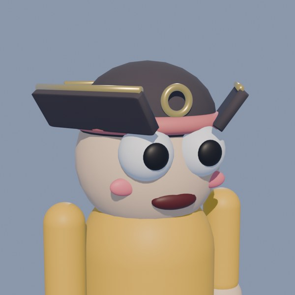
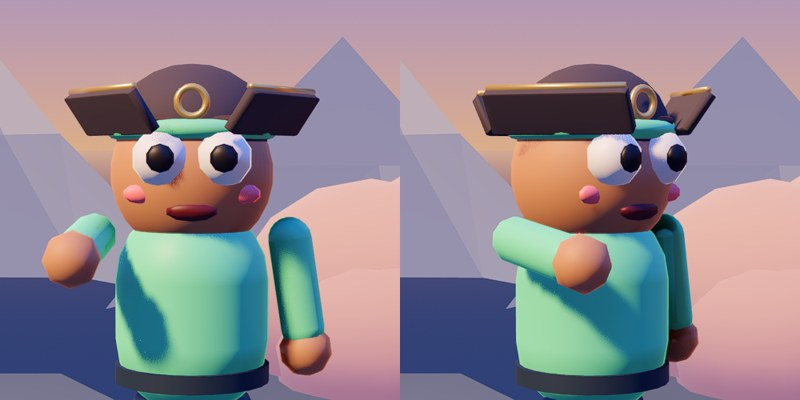

# Your own character models

Hats, head extras, outfits, the Yeet's own body parts and the gravity gun can be your models.
Make them in Blender, save them into a folder, and they're in the game: no code to change.

| Folder | What it is | Where it shows up |
|---|---|---|
| `assets/characters/hats/` | a hat | Character menu → **Hat**, after the built-in hats |
| `assets/characters/extras/` | a head extra (glasses, a mask, a mustache...) | Character menu → **Head extra** |
| `assets/characters/outfits/` | an outfit over the torso | Character menu → **Outfit** (the picker appears once there is one) |
| `assets/characters/parts/` | replaces a body part's built-in shape | on every classic Yeet (see [Body parts](#replacing-body-parts)) |
| `assets/characters/guns/` | a gravity gun: `default.glb` is the one everyone carries, any other can be picked | Character menu → **Gun** (see [Your own gravity gun](#your-own-gravity-gun)) |

The file name becomes the name in the menu: `pirate_hat.glb` → *Pirate hat*. Files can be
`.glb` / `.gltf` (from Blender) or Godot scenes (`.tscn` / `.scn`).

There's an example to look at: **`assets/characters/hats/pirate_hat.glb`**, made by
`tools/make_example_hat.py` with the exact steps below.

## Before you start: the character file

Open **`art/characters/characters.blend`** in Blender (4.x or 5.x). It holds the whole Yeet
as the game builds it, in collections you switch on and off with the eye icons:

- **Body**: the classic Yeet, standing on the ground, with the classic face.
- **Hats/…**, **Head extras/…**, **Outfits/…**: every built-in part, already sitting where
  it belongs. Switch one on to see how big things are and where they sit.
- **Characters/Noor Yeet**: Noor's own look.

Things to know about the file:

- **The Yeet faces +Y.** Look at its face with the **Back** view (Ctrl + Numpad 1);
  Front (Numpad 1) shows the back of its head.
- **1 unit = 1 metre**, Z is up, the feet stand at Z = 0.
- **Where the parts are** (their pivots: the point each part turns around when the Yeet
  moves):

  | Part | Pivot (X, Y, Z) | Notes |
  |---|---|---|
  | head | (0, 0, 1.55) | a ball of radius 0.36: its top is at Z 1.91 |
  | torso | (0, 0, 0.95) | |
  | arm_r / arm_l | (±0.43, 0, 1.28): the shoulders | the Yeet's right arm is at +X; the gun is in its right hand |
  | leg_r / leg_l | (±0.16, 0, 0.55): the hips | |

The important rule: **model the part where it sits on the standing Yeet** and leave it there.
Don't move it to the origin and don't parent it to the body's empties. The game works out
which body part it's on and keeps it there as the Yeet runs, jumps and ragdolls.

## Making a hat, step by step

1. **Open** `art/characters/characters.blend`. Switch on **Body** (and a built-in hat of a
   similar size, for reference). Switch the other collections off.
2. **Make a new collection** for your hat (right-click the Scene Collection → *New
   Collection*), so it's easy to select on its own.
3. **Model the hat on the head.** Add your shapes and place them on the head in the Back view
   and from the side. Check it from all round: it should sit on the head, not float above it
   or sink deep into it (a little overlap is good).
4. **Materials.** Every material keeps its colour and textures, except two names:
   - a material named **`Shirt`** (or **`Team`**) is painted the player's shirt colour,
     which is the **team colour** in team modes. Use it for a band or a stripe, so teams
     stay easy to tell apart.
   - a material named **`Skin`** takes the player's skin tone (for ears, a nose...).
5. **Keep it light.** A few hundred to a couple of thousand triangles is plenty: a whole
   Yeet with a hat is about 5,000, and there can be a dozen on screen. Modifiers (bevel,
   subdivision) are fine: they're applied on export.
6. **Export.** Select only your hat's objects (click the collection, or box-select), then
   *File → Export → glTF 2.0*:
   - **Format**: glTF Binary (.glb)
   - **Include → Limit to: Selected Objects** ✔
   - **Transform → +Y Up** ✔ (it's on by default)
   - **Data → Mesh → Apply Modifiers** ✔
   - Save as `assets/characters/hats/<your_hat_name>.glb` in the Yeetwork folder.
7. **See it in the game.**
   - From the **Godot editor**: switch to the editor window (it imports the new file by
     itself), then play (F5). Open *Character* in the main menu and step through **Hat**:
     yours is after the built-in ones.
   - The **built game** (`Yeetwork.exe`) only has the models that were there when it was
     exported: export it again (*Project → Export*), or ask Claude to build it.

Changing it later: edit, export over the same file, and the game picks up the new version
(after the editor imports it, or a new export of the game).

## Head extras and outfits

The same steps, with a different folder:

- **Head extras** (`assets/characters/extras/`): glasses, masks, mustaches, earrings... Model
  them on the head, like a hat. They're worn together with any hat (except the pumpkin
  head, which covers the face).
- **Outfits** (`assets/characters/outfits/`): model them over the torso (pivot at Z 0.95):
  a vest, a cape, armour, a backpack. The shirt underneath stays, so a `Shirt` material on
  the outfit isn't needed unless you want the team colour on the outfit itself. Players pick
  them under **Outfit** in the character menu.

## Replacing body parts

A file in `assets/characters/parts/` named after a body part replaces that part's built-in
shape on every classic Yeet (Noor keeps her own look):

`head.glb`, `torso.glb`, `arm_r.glb`, `arm_l.glb`, `leg_r.glb`, `leg_l.glb`

- Model it in place on the standing Yeet, like everything else (switch off the part you're
  replacing in the Body collection to see where it goes). It turns around the part's pivot
  (the table above), so a new arm swings from the shoulder.
- **A new head keeps the game's face**: the eyes, mouth, brows and cheeks still sit in front
  of it, blink, look around and react. Model the head so the face sits on it (the eyes'
  fronts are at Y ≈ 0.4, Z ≈ 1.62).
- The gun stays in the right hand: an `arm_r` model should end with a hand near
  (0.43, 0.05, 0.73).
- Use `Shirt` for clothing (sleeves, a jacket) and `Skin` for skin, so team colours and skin
  tones still work.

## Your own gravity gun

Your gun replaces the built-in one, or sits beside it as a version players can pick:

- **`assets/characters/guns/default.glb`** is the **Default Gun**: everyone carries it,
  bots too. The built-in gun is then *Classic* in the menu.
- **Any other name** (`rusty_gun.glb`) is another version: Character menu → **Gun** →
  *Rusty gun*. Everyone in the match sees the gun each player picked.

There's an example: **`assets/characters/guns/scrap_gun.glb`** (*Scrap gun* in the menu), made
by `tools/make_templates.gd`, with every named part below and its own actions. Open it in
Blender (File → Import → glTF) to see how it's put together.

**Start from the built-in gun**: `art/gravity_gun/gravity_gun.blend`. Save a copy under a new
name and model yours over it, so it's the same size, held in the same place and points the
same way (along Blender's +Y). Keep these names; the game finds them by name:

| Name | What it is | Without it |
|---|---|---|
| `Muzzle` | an empty at the front: where the beam starts | the beam starts at the Yeet's eyes |
| `Grip` | an empty where the hand holds it | held where the built-in gun's grip is |
| `Core` | the part that pulses while something's held, more as a throw charges | nothing pulses |
| `ClawPivot0`, `ClawPivot1`, `ClawPivot2` | each with one child (a hinge) that opens as you grab: it turns around its X axis | no claws open |
| `Accent` | a material: it takes the team colour (orange outside team modes) | no team colour on the gun |

**Your own actions (optional).** Animate it in Blender (object animation is enough: keyframe
the claws' hinges, the core's scale, a barrel kicking back) and name the actions:

| Action | Plays |
|---|---|
| `Grab` | as something's caught (once) |
| `Hold` | while it's held (loops) |
| `Charge` | while a throw winds up (once: make it as long as a full charge, 1 second) |
| `Throw` | as it's thrown, and on a push (once: end it where the gun rests) |
| `Idle` | the rest of the time (loops) |

With any of these the game leaves the claws and the core to your actions; without them it
moves them itself. Leave out the ones you don't need. Export as .glb with *Animation* ticked
(and *+Y Up*, like everything else).

**Hand-painted textures**: use .glb (it packs the images in). An `Accent` material with a
texture is tinted by the team colour, so paint its parts light (white or light grey).

**Try it quickly**: `godot --path . -- --host --map prime --bots 0 --gun rusty_gun` (the file's
name without `.glb`) starts a match carrying it, whatever the menu says.

## Changing a built-in part

The built-in hats and extras are made by the game's code (`scripts/player/character_model.gd`),
so they can't be edited in place. To make your own version of one: copy its collection in
the .blend (e.g. *Hats/Top hat*), change the copy, and export it as a custom hat with a new
name. The original stays in the list too.

## Playing online

Custom models are packed into the game when it's exported, so everyone playing together
needs **the same build**. A player with an older build sees the hair tuft instead of a hat
their game doesn't have.

## When something's wrong

| Problem | Likely cause |
|---|---|
| It isn't in the menu | Wrong folder or file type, or the game was started before the file was there (restart; for the .exe, export again). |
| It floats, or sits inside the Yeet | It was moved away from where it sits on the Yeet (to the origin, say) before export. Put it back on the body, export again. |
| It faces backwards | It was modelled facing −Y. The Yeet faces +Y in the .blend (Back view). |
| It's lying on its side | *+Y Up* was off in the export settings. |
| No team colour | The material isn't named `Shirt` (or `Team`). |
| Textures missing | Use .glb (it packs the images in), not .gltf with separate files. |
| Far too big or small | The scene's unit scale was changed. The Yeet is about 2 m tall: model to that. |
| The gun points sideways or at you | It wasn't modelled over the built-in gun (it points along Blender's +Y). |
| The beam starts in the wrong place | The `Muzzle` empty is missing or not at the front. |
| The claws don't move | They aren't `ClawPivot0-2` with one child each, or the gun has its own actions (then they move only in those). |

## For reference

- `scripts/player/character_parts.gd` finds the files; `CharacterModel._add_custom()` puts
  them on the Yeet. `GravityGun.make_model()` builds a gun, `_update_actions()` plays its
  actions.
- `art/characters/characters.blend` is made from the game's code. If the built-in parts
  change, it can be rebuilt (see the README's *Characters* section). Keep your own work in
  your own .blend files or collections, or re-add it after a rebuild.
- `tools/make_example_hat.py` builds the example hat and exports it:
  `blender --background art/characters/characters.blend --python tools/make_example_hat.py`
