# Your first custom map, step by step

This guide walks you through making a small Yeetwork map in Godot, playing it, giving it
your own textures and models, and sharing it as a **map pack** your friends can drop into
their game. It takes about 15 minutes. You'll end up with this:

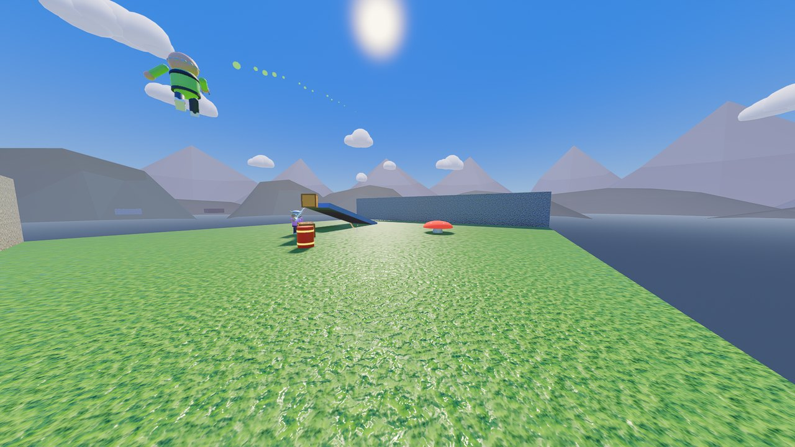

Every piece you'll use is described in more detail in [MAPPING.md](MAPPING.md); the short
version of this guide is [custom/README.md](../custom/README.md).

---

## 0. What you need

- **Godot 4.7.2**, the standard version (not .NET): <https://godotengine.org/download>.
  It's a single program, nothing to install.
- **Godot's export templates** (only for the last part, making a map pack): in Godot,
  *Editor → Manage Export Templates → Download and Install*.
- **The Yeetwork project**: this folder, with `project.godot` in it.

> **Make maps inside the Yeetwork project, not in a new empty Godot project.** The pieces
> you build maps from (blocks, spawn points, jump pads...) are part of Yeetwork. A map
> copied into an empty project loses them.

## 1. Open the project

Start Godot. In the Project Manager click **Import**, pick `project.godot` in the Yeetwork
folder and click **Import & Edit**. The first time, Godot spends a minute importing
everything.

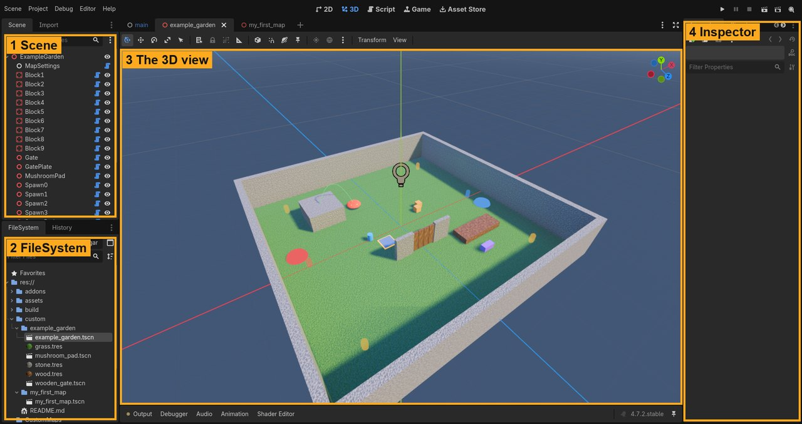

The four areas you'll use:

1. **Scene**: the nodes (pieces) of the map you're editing, as a list.
2. **FileSystem**: the project's files. Your maps live in `custom/`.
3. **The 3D view**: your map. Hold the **right mouse button** and use **W A S D** to fly
   around (like in a game); the mouse wheel changes the speed. **F** frames the selected node.
4. **Inspector**: the settings of the node you selected.

Click a piece in the 3D view to select it (that's the **Yeetwork Map Kit** plugin at work:
it's switched on in the project, under *Project → Project Settings → Plugins*).

Want to look around first? Double-click `custom/example_garden/example_garden.tscn` in the
FileSystem: it's a small finished map.

## 2. Make a folder for your map

In the **FileSystem**, right-click the `custom` folder → **Create New → Folder...**, and call
it `my_first_map` (lowercase, no spaces). Everything your map uses goes in this folder:
the map itself, and later its textures, models and sounds.

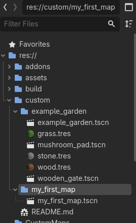

## 3. Create the map's scene

1. **Scene → New Scene**.
2. In the Scene dock, click **3D Scene**. You get one node called `Node3D`.
3. Double-click it and rename it `MyFirstMap`.
4. **Scene → Save Scene** (Ctrl+S): save it in `custom/my_first_map/` as `my_first_map.tscn`.

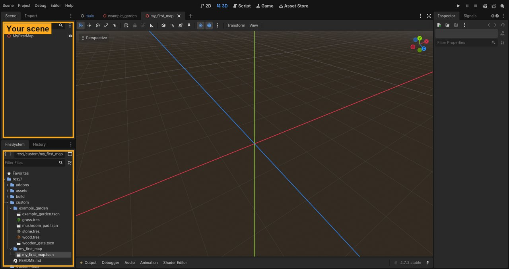

## 4. Add MapSettings

Every map needs one **MapSettings** node: its name, sky, ocean and so on.

1. Select `MyFirstMap` in the Scene dock.
2. **Add Child Node**: the **+** button at the top of the Scene dock, or **Ctrl+A**.
3. Type `MapSettings` in the search box, pick it, click **Create**.
4. In the Inspector set **Map Name** (what the game's map list shows), **Author**, and pick a
   **Sky** (try `day`).

| | |
|---|---|
| 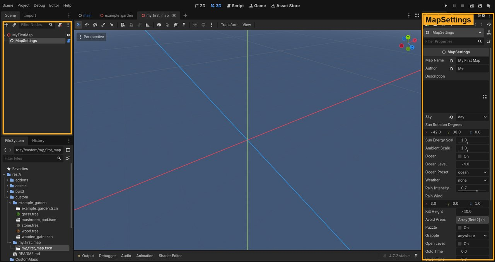 | 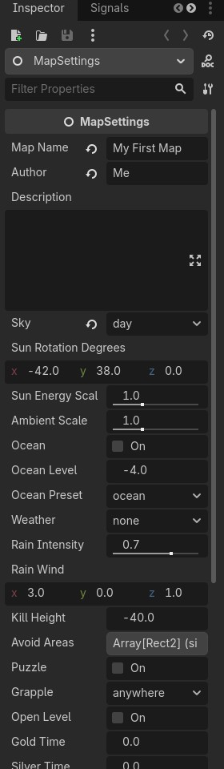 |

Every Map Kit piece is added the same way (Ctrl+A, type its name): `ArenaBlock`,
`SpawnPoint`, `FlagStand`, `PropSpawn`, `JumpPadNode`, `LiftPlatform`, `HazardVolume`,
`BreakableSlab` and the puzzle pieces.

## 5. A floor

1. Select `MyFirstMap`, **Ctrl+A**, add an **ArenaBlock**. Rename it `Floor`.
2. In the Inspector, set **Size** to `30, 1, 30` (30 × 30 m, 1 m thick).
3. Under **Node3D → Transform**, set **Position y** to `-0.5`, so the top of the floor is at 0.

> **Resizing in the 3D view:** a selected block has a small handle on each face: drag one
> and that face moves while the opposite one stays put (hold **Ctrl** to snap to whole
> metres). The **Scale tool** (R) works too: when you let go, the scale is turned into
> **Size** and the scale goes back to 1, because a scaled block collides wrong. Ctrl+Z undoes
> either.

| | |
|---|---|
| 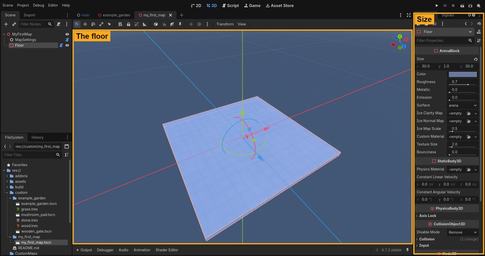 | 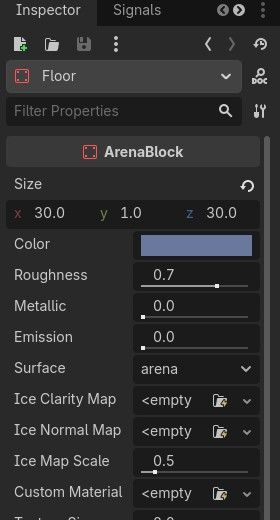 |

## 6. Walls and a ramp

1. Select `Floor` and **duplicate** it (Ctrl+D). Set the copy's Size to `30, 4, 1` and its
   Position to `0, 2, -15.5`: a wall along one edge. Duplicate the wall for the other edge
   (Position z `15.5`). Close the other two sides the same way if you like (Size `1, 4, 30`).
2. Duplicate again for a ramp: Size `4, 0.5, 8`, and under Transform set **Rotation x** to
   `18`. Yeets can walk up slopes up to about 46°.

Moving things by hand: select a node, press **W** (move) or **E** (rotate) and drag the
coloured arrows in the 3D view.

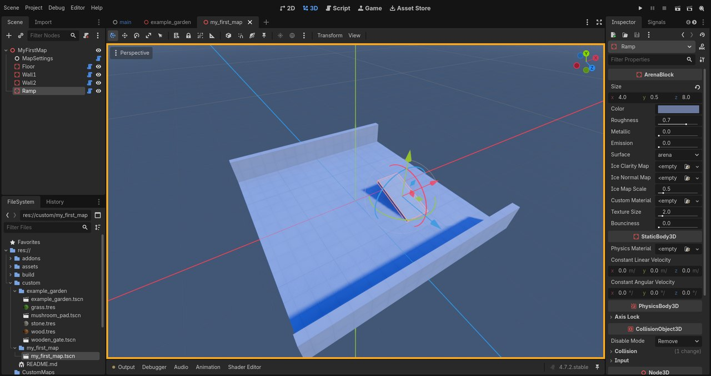

## 7. Spawn points

Add four **SpawnPoint** nodes and spread them around the floor (Position e.g. `-10, 0, -10`,
`10, 0, -10`, `-10, 0, 10`, `10, 0, 10`). **Team**: `Any` for free-for-all. For Capture the Flag,
add some `Red` and `Blue` spawn points and one **FlagStand** per team too.

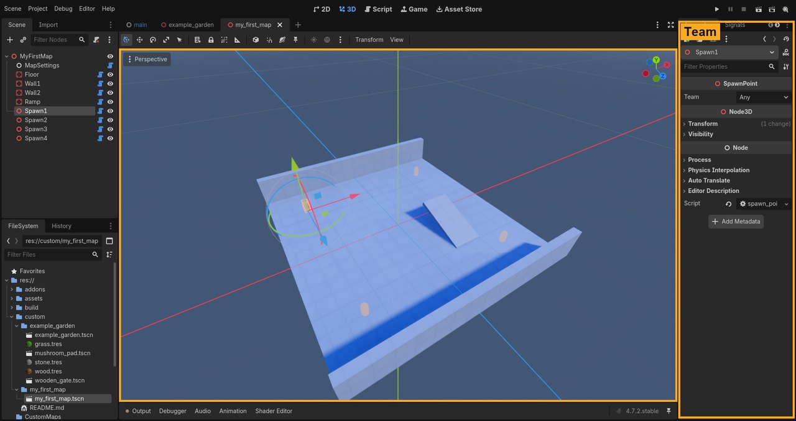

## 8. A jump pad

Add a **JumpPadNode** and put it on the floor. Its **Target** is where it throws you
(relative to the pad), **Arc Height** how high the throw goes; the 3D view draws the
flight path in green.

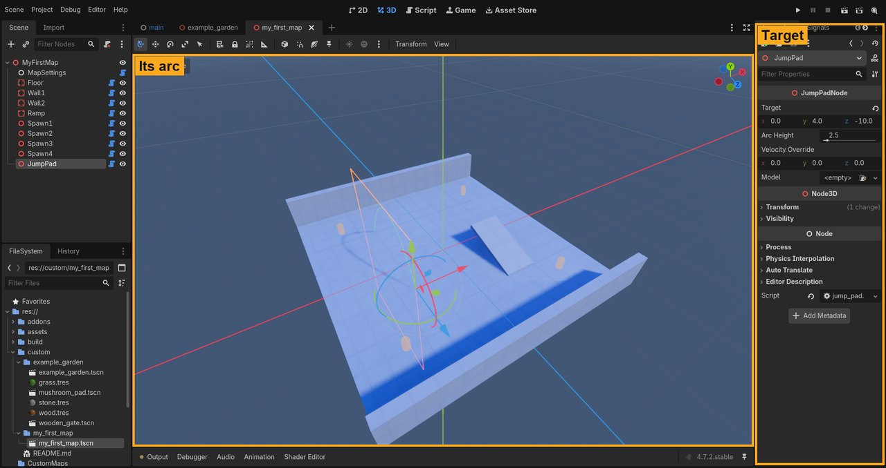

## 9. Props

Add a few **PropSpawn** nodes: things to grab and throw. **Kind** picks what: `crate`,
`barrel`, `boom_barrel` (it explodes!), `ball`, `anvil`, `couch`... Lift them a little above
the floor (crate Position y `0.6`).

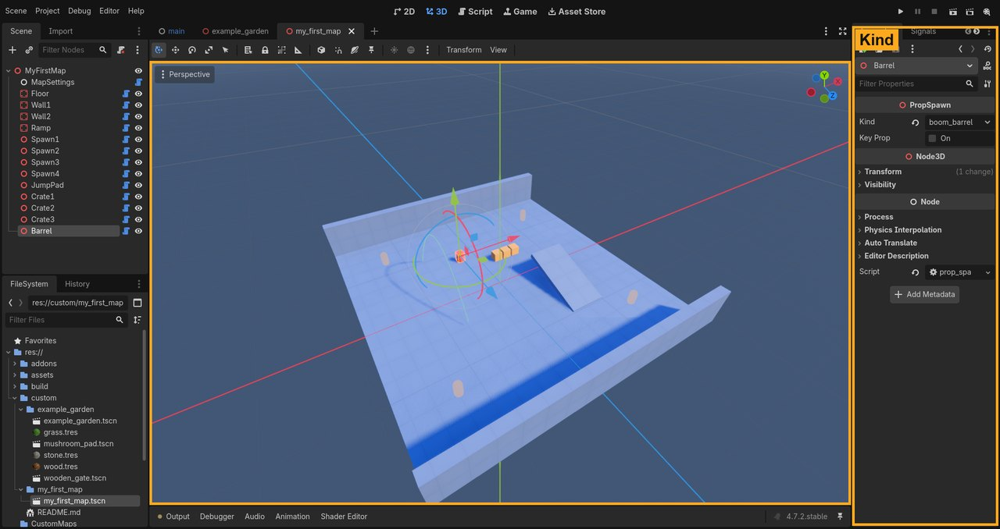

**Pickups:** add a **PickupSpawn** on the floor for a first aid kit (**Kind** `health`) or a
power-up (`speed`, `super`, `feather`, `iron`, or `random`). It floats over a glowing pad
and comes back a while after someone takes it.

## 10. Play it!

Save (Ctrl+S) and press **F6** (*Run Current Scene*, the clapperboard button at the top
right). The game starts right on your map, with bots (MapSettings: **Playtest Mode** and
**Playtest Bots** pick the mode and how many). Press **Esc** for the menu, and close the game
window to get back to the editor.


Optional: a quick check of your map from a terminal in the project folder:

```bash
godot --headless --path . -- --map res://custom/my_first_map/my_first_map.tscn --validate
```

It lists problems and warnings. "No Red spawn points" and "CTF needs one Red and one Blue
FlagStand" only matter if your map is meant for team modes.

## 11. Your own textures (PBR materials)

1. Drag your texture images (PNG/JPG: albedo/colour, normal map, roughness...) from Windows
   Explorer into `custom/my_first_map/` in the FileSystem.
2. Right-click the folder → **Create New → Resource... → StandardMaterial3D**, save it as e.g.
   `rock.tres`. Double-click it and in the Inspector fill in **Albedo → Texture**, **Normal Map**
   (tick *Enabled*, then its Texture), **Roughness → Texture** and so on.
3. Select a block and drag the material onto its **Custom Material** slot. **Texture Size** is
   how many metres one repeat of the texture covers; it tiles evenly whatever the block's size.

Every setting of the material works on the block and shows as you change it: normal map
strength, **Height** (parallax: try a Scale of 1–4 first; high values look stretched),
**Ambient Occlusion** (it only darkens the ambient light, so it shows mostly in shade), UV1
Scale / Offset and so on.

To try it right away, drag `custom/example_garden/grass.tres` onto your floor (Texture Size
`4`) and `stone.tres` onto the walls.

| | |
|---|---|
| 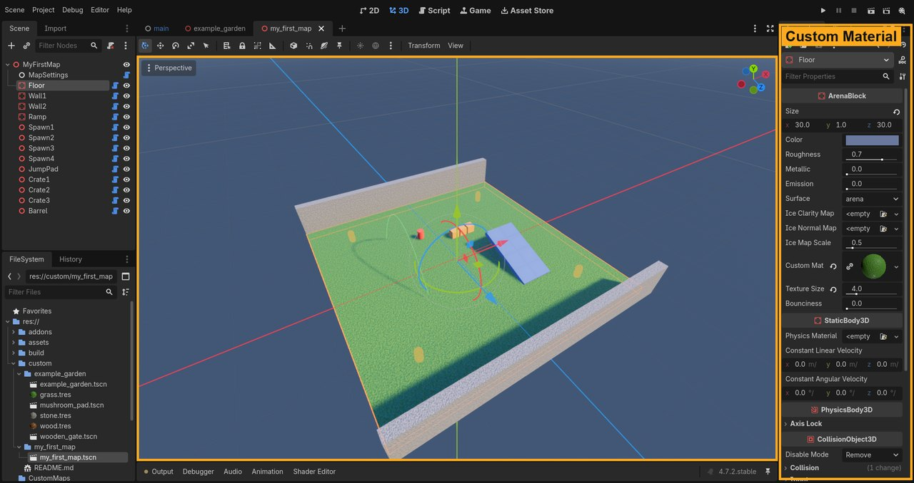 | 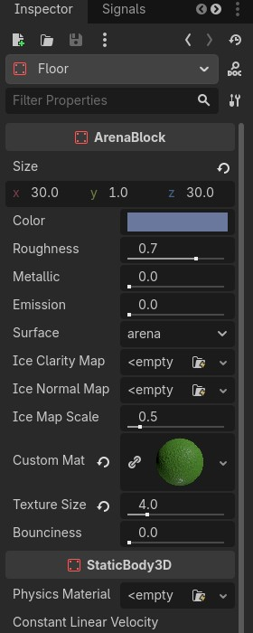 |

## 12. Your own models

Drag `.glb`, `.gltf`, `.fbx` or `.blend` models into your map's folder. Then either:

- **Scenery**: drag the model from the FileSystem into the 3D view. Players walk through it
  unless it has collision: select its mesh and use the 3D view's **Mesh → Create Collision
  Shape...** menu (or place ArenaBlocks inside it as invisible walls).
- **The look of a Map Kit piece**: jump pads, lifts, doors, buttons and pressure plates have a
  **Model** slot. Drag your model (or a scene) onto it: the piece works the same, only its look
  changes. (A button's model can have a child named `Cap` that moves when pressed; a pressure
  plate's, a child named `Plate` that sinks.)

Try it: drag `custom/example_garden/mushroom_pad.tscn` onto your jump pad's **Model**.

| | |
|---|---|
| 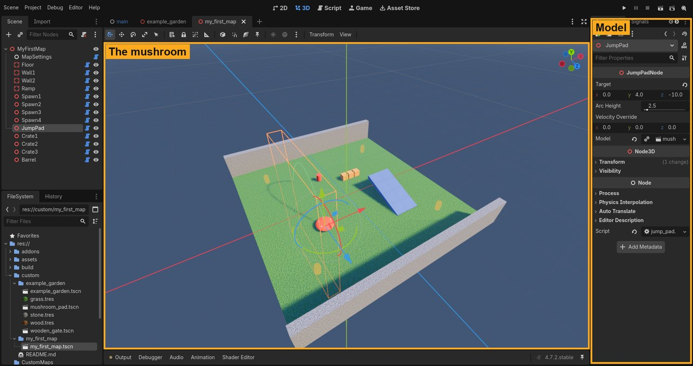 | 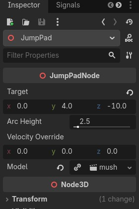 |

And in the game:

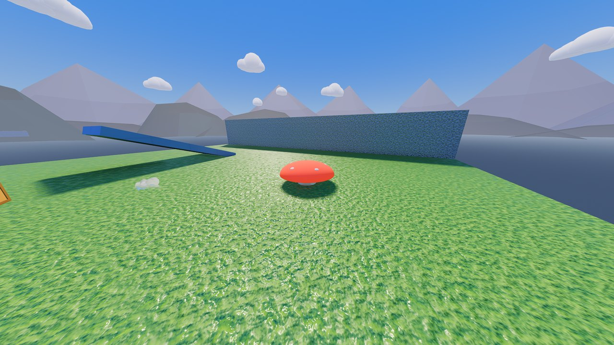

## 13. Your own functionality (optional)

You can attach your own scripts to nodes (right-click a node → **Attach Script**) for moving
scenery, effects or special rules; keep the scripts in your map's folder. Two things to know:

- A map pack with scripts runs code on the computer of everyone who plays it, so the game
  **asks players before loading it** ("only allow packs from people you trust"). Packs without
  scripts load straight away.
- Scripts run on each player's computer separately. Anything that must be the same for
  everyone (doors, switches, scores) is best built from the Map Kit's puzzle pieces, which the
  game keeps in sync (see [MAPPING.md](MAPPING.md), "Puzzle pieces").

## 14. Make a map pack

Save your map, then in a terminal (or a Command Prompt) in the project folder:

```bat
set GODOT=C:\Godot\Godot_v4.7.2-stable_win64_console.exe
tools\export_map_pack.bat my_first_map
```

(Use the path of your Godot; on Linux it's `GODOT=/path/to/godot tools/export_map_pack.sh my_first_map`.)
When it's done it says:

```
Exporting 1 scene(s) of res://custom/my_first_map to .../build/map_packs/my_first_map.zip
MAP PACK READY: .../build/map_packs/my_first_map.zip
Put it in the game's "maps" folder (next to Yeetwork.exe).
```

`my_first_map.zip` holds your map and everything in its folder (a few KB to a few MB with
textures and models). The game's own files stay out: players already have them.

## 15. Install it and play

1. Make a folder called `maps` next to `Yeetwork.exe` (or `Yeetwork.x86_64` on Linux and the
   Steam Deck) and put the `.zip` in it. (Or use the game's data folder:
   `%APPDATA%\Godot\app_userdata\Yeetwork\maps` on Windows,
   `~/.local/share/godot/app_userdata/Yeetwork/maps` on Linux.)
2. Start the game, **PLAY**: your map is in the **Map** list as *My First Map (custom)*.

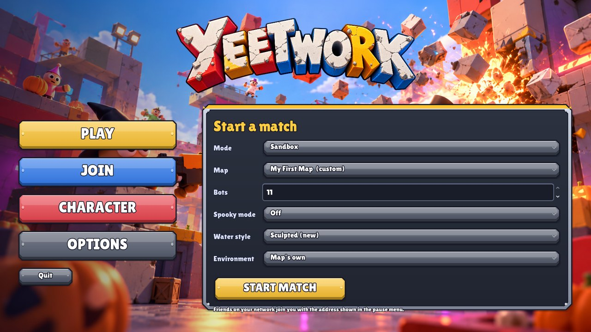

## 16. Play it with friends

Everyone who plays needs the same `.zip` in their `maps` folder. The host picks the map;
a friend who doesn't have it is told which map pack to get.

---

## When something doesn't work

| Problem | What to check |
|---|---|
| My map isn't in the map list | It needs a **MapSettings** node, and must be saved in `custom/<your_map>/`. A map pack must be in the `maps` folder next to the game (not inside another folder). |
| The game says the pack is "waiting to be allowed" | It has scripts: click **Allow** on the PLAY page (only for packs you trust). |
| The export fails | Godot's export templates must be installed (step 0), and `GODOT` must point to your Godot. |
| Textures or models are missing in the pack | Only what's in your map's folder goes into the pack: keep every texture and model in `custom/<your_map>/`. |
| Players fall through something | Imported models need collision (step 12). |
| A warning triangle about "non-uniform scale" on a block | Select the block and do anything (e.g. nudge it): the Map Kit plugin turns the scale into Size. Or set Scale back to 1 and type the Size. |
| The texture looks blurry | Check the Albedo slot holds the full-size texture, not a small preview/thumbnail image. |
| Clicking a block in the 3D view doesn't select it | The **Yeetwork Map Kit** plugin must be on: *Project → Project Settings → Plugins*, tick *Enable*. (Selecting it in the Scene list always works.) |
| F6 starts the wrong map | F6 runs the scene in the tab you're looking at: click your map's tab first. |
| Errors about missing pieces after copying a map | Maps must be made in the Yeetwork project (step 0). |

More: every node and setting is described in [MAPPING.md](MAPPING.md), and the example
map is `custom/example_garden/`.
