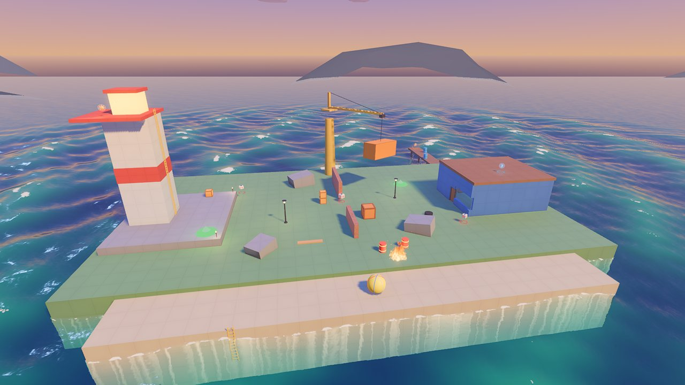
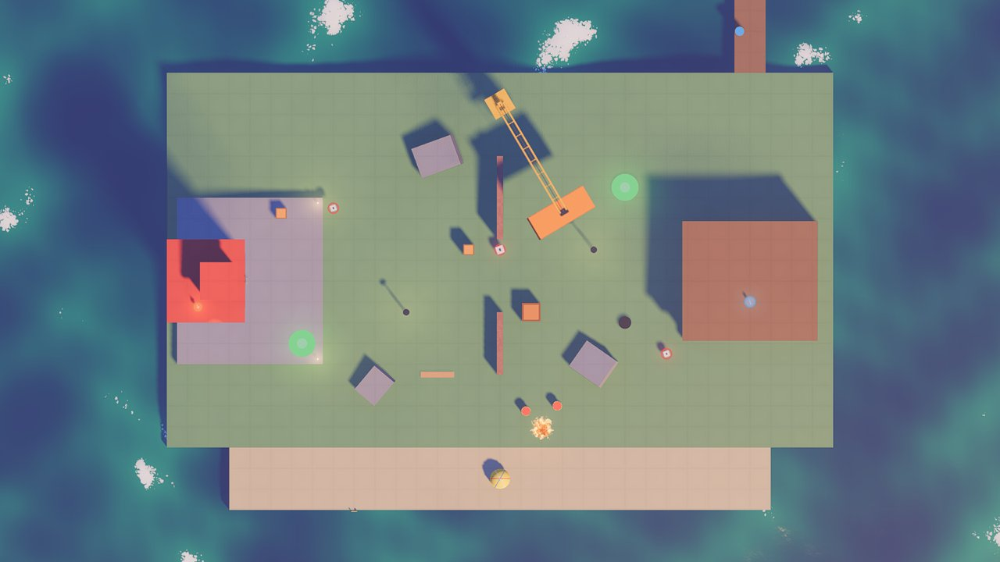
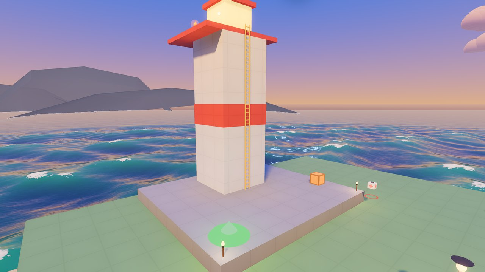
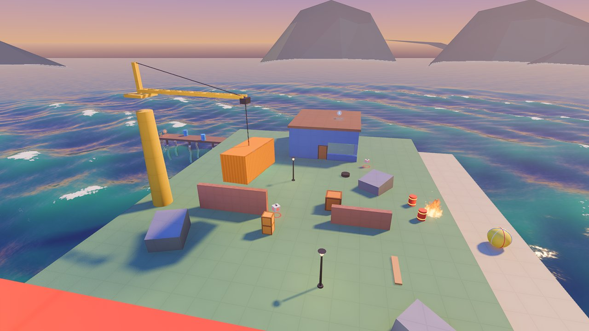
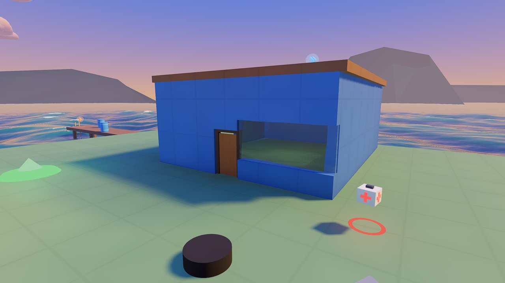
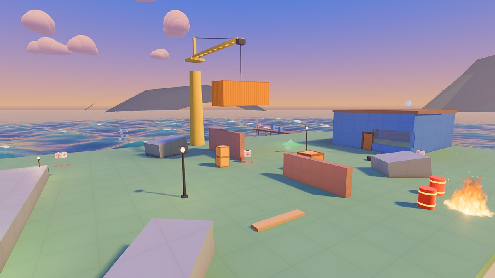
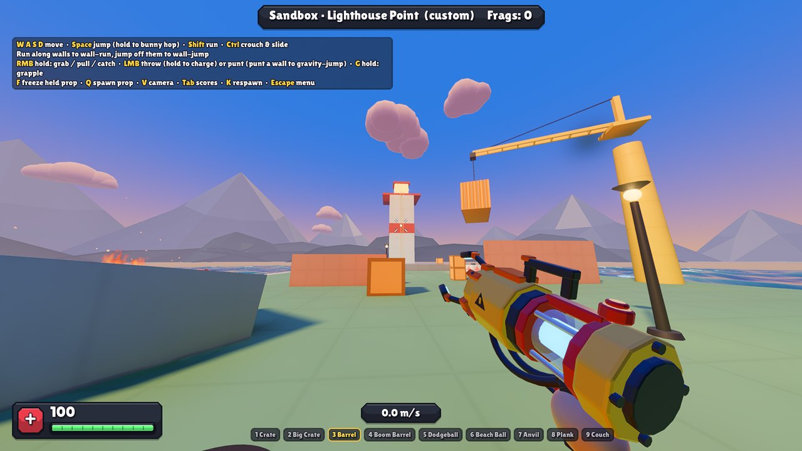

# Make a new map: Lighthouse Point, from an idea to a map pack

[Rebuild a real map](REBUILD_A_MAP.md) copied a map that already exists. This one starts from
nothing but an idea, and goes the way a map really gets made: a plan, a rough block-out you
play straight away, then each base, the middle, the people and the things, a test with bots,
fixes, and a pack to share. It uses a bit of everything: a ladder, a crane, a door the gun
rips off, glass, a humming machine, lights, fire, the sea.



The finished map is in the project: `custom/lighthouse_point/lighthouse_point.tscn`. Open it
next to yours whenever you want to check something. The tables below are made from it, so
they always match it. Every piece links to its page, with all its settings
([the pieces](pieces/README.md)).

You should know your way round the editor first: [Your first custom map](CUSTOM_MAPS_GUIDE.md)
(15 minutes), and ideally [Rebuild a real map](REBUILD_A_MAP.md).

---

## 1. The idea, and a plan

Start with one sentence: *Capture the Flag on a headland at sunset: Red holds the lighthouse,
Blue the boathouse, and the sea is all round.* Then decide on paper (or in your head) what
makes it play well. Some rules of thumb that work in Yeetwork:

- **Size**: about 60 x 40 m for 8 to 10 players. Yeets are fast and the gun throws things far;
  a bigger map feels empty.
- **More than one way** between the bases: here through the middle, along the beach, along the
  north shore, over the boathouse roof, and riding the crane.
- **High ground** that's worth the climb, and a way to get it back: the lighthouse gallery (a
  long ladder, or a jump pad), the boathouse roof (a jump pad).
- **Cover** in the middle (walls, rocks, crates), and things to **throw** near where people
  fight.
- **Something that changes**: walls that break, a door that comes off, barrels that explode.
- **A landmark**: you always know where you are when you can see the lighthouse.



Positions in this guide: **x** runs west to east (Red to Blue), **z** north to south, **y** is
up, in metres. A Position is the node's position in the Inspector; a Rotation is in degrees;
a colour like `#73a061` goes in the colour picker's **Hex** box. Leave every setting that
isn't listed as it is.

## 2. The folder, the scene, the settings

1. Make the folder `custom/lighthouse_point/` (a map's folder is what becomes its pack: keep
   everything the map uses in it).
2. A new scene, root **Node3D** named `LighthousePoint`, saved as
   `custom/lighthouse_point/lighthouse_point.tscn`.
3. A **MapSettings**:

<!-- nodes res://custom/lighthouse_point/lighthouse_point.tscn named MapSettings -->
| Setting | Set it to |
|---|---|
| **Map Name** | Lighthouse Point |
| **Author** | Yeetwork Map Kit |
| **Description** | A headland at sunset: Red holds the lighthouse, Blue the boathouse. A ruined wall, a campfire, a crane over the middle, and the sea all round. |
| **Ocean** | on |
| **Ocean Level** | -1.5 |
| **Ocean Swimmable** | on |
| **Kill Height** | -20 |
| **Playtest Mode** | Capture the Flag |
| **Playtest Bots** | 5 |
<!-- /nodes -->

**Ocean Swimmable**: who falls in the sea can swim, and climb out up a ladder (we'll put
some in). **Playtest Mode** and **Playtest Bots**: what F6 plays, and with how many bots.

## 3. Block it out, and play it

The ground first, nothing else: a **Node3D** `Ground`, and under it a big grassy headland, a
lower sandy beach to the south, and three rocks (tilted blocks: **Rotation** y turns them,
z tips them).

<!-- nodes res://custom/lighthouse_point/lighthouse_point.tscn under Ground -->
| Name | Add | Position | Rotation | Settings |
|---|---|---|---|---|
| Headland | [ArenaBlock](pieces/ArenaBlock.md) | (0, -3, -2) |  | Size: (64, 6, 36); Color: #739e61 |
| Beach | [ArenaBlock](pieces/ArenaBlock.md) | (0, -3.5, 19) |  | Size: (52, 6, 6); Color: #dbc78f |
| Rock0 | [ArenaBlock](pieces/ArenaBlock.md) | (-6, 0.77, -12) | (0, 20, 8) | Size: (4, 2.2, 3); Color: #9e9994 |
| Rock1 | [ArenaBlock](pieces/ArenaBlock.md) | (9, 0.63, 8) | (0, -35, 8) | Size: (3.5, 1.8, 3); Color: #9e9994 |
| Rock2 | [ArenaBlock](pieces/ArenaBlock.md) | (-12, 0.525, 10) | (0, 50, 8) | Size: (3, 1.5, 2.5); Color: #9e9994 |
<!-- /nodes -->

Now press **F6** and run about. This is the most useful minute of the whole map: is it too
big, too small, can you get up on the rocks? Changing a block now is easy; after everything
else is on it, it isn't. Play it again after every step below.

## 4. Red's base: the lighthouse

A **Node3D** `Lighthouse`: the yard (a stone platform 1 m up), the tower, the gallery round
its top, the lamp room, the way up, the flag, two torches.

<!-- nodes res://custom/lighthouse_point/lighthouse_point.tscn under Lighthouse -->
| Name | Add | Position | Rotation | Settings |
|---|---|---|---|---|
| Yard | [ArenaBlock](pieces/ArenaBlock.md) | (-24, 0.5, 0) |  | Size: (14, 1, 16); Color: #9e9994 |
| Tower | [ArenaBlock](pieces/ArenaBlock.md) | (-27, 8, 0) |  | Size: (5, 14, 5); Color: #edebe0 |
| TowerBand | [ArenaBlock](pieces/ArenaBlock.md) | (-27, 8, 0) |  | Size: (5.1, 2, 5.1); Color: #c74038; Solid: off |
| Gallery | [ArenaBlock](pieces/ArenaBlock.md) | (-28.25, 15.2, 0) |  | Size: (7.5, 0.4, 8); Color: #c74038 |
| LampRoom | [ArenaBlock](pieces/ArenaBlock.md) | (-27, 16.65, 0) |  | Size: (3, 2.5, 3); Color: #ffd973; Emission: 1.5 |
| LampRoof | [ArenaBlock](pieces/ArenaBlock.md) | (-27, 18.1, 0) |  | Size: (3.6, 0.4, 3.6); Color: #c74038 |
| TowerLadder | [Ladder](pieces/Ladder.md) | (-24.4, 1, 0) | (0, 90, 0) | Height: 14.8; Over The Top: 2.5 |
| ToTheGallery | [JumpPadNode](pieces/JumpPadNode.md) | (-19, 1, 6) |  | Target: (-6, 14.4, -3); Arc Height: 2 |
| Beam | [Spinner](pieces/Spinner.md) | (-27, 16.9, 0) |  | Speed: 0.6 |
| FlagRed | [FlagStand](pieces/FlagStand.md) | (-21, 1, 0) |  | (as it comes) |
| TorchN | [MapLight](pieces/MapLight.md) | (-17.5, 1, -7.5) |  | Kind: torch |
| TorchS | [MapLight](pieces/MapLight.md) | (-17.5, 1, 7.5) |  | Kind: torch |
<!-- /nodes -->



What's going on here:

- **TowerBand** is a red stripe round the tower: a block with **Solid** off, a little bigger
  than the tower, only seen. **LampRoom** glows (**Emission**).
- **TowerLadder**: a [Ladder](pieces/Ladder.md) is put at the foot of the wall, its blue arrow
  (+Z) pointing away from the wall, toward who climbs it: the tower's east face looks east, so
  it's turned 90 degrees. Its **Height** reaches a little above the gallery, or climbers stick
  at the top. The gallery sits west of the ladder, not over it: a ladder can't climb past an
  overhang.
- **ToTheGallery**: a [jump pad](pieces/JumpPadNode.md) from the yard to the gallery, 14 m up.
  Its **Target** is measured from the pad. Select it and the green arc shows where it throws you;
  drag the Target till the arc lands on the gallery.
- **The beam**: two pieces together. A [Spinner](pieces/Spinner.md) turns whatever is under it,
  and under **Beam** there's a [MapLight](pieces/MapLight.md) spotlight, tipped down a little,
  pointing out from the lamp room:

<!-- nodes res://custom/lighthouse_point/lighthouse_point.tscn under Beam -->
| Name | Add | Position | Rotation | Settings |
|---|---|---|---|---|
| Spotlight | [MapLight](pieces/MapLight.md) | (0, 0, -1.6) | (-8, 0, 0) | Kind: spotlight; Color: #ffebb3; Energy: 4; Reach: 60; Breakable: off |
<!-- /nodes -->

  (Breakable off: nobody shoots out the lighthouse.) Pieces can go under other pieces like
  this: put lights under a lift, a fan on a turntable.



## 5. Blue's base: the boathouse

A **Node3D** `Boathouse`: walls round a shed with a front door and a big window, a back
doorway to the jetty, a roof, the flag inside, a generator, a light, the jetty with a ladder
up from the sea, and a jump pad onto the roof.

**Your door's model goes in your folder.** The door is the starter model
`custom/make_your_own/models/door.glb` (a door of planks in a frame). Copy it into
`custom/lighthouse_point/models/` first and use the copy: a map pack takes only what's in the
map's folder, so a model from anywhere else would be missing from it.

<!-- nodes res://custom/lighthouse_point/lighthouse_point.tscn under Boathouse -->
| Name | Add | Position | Rotation | Settings |
|---|---|---|---|---|
| BackWall | [ArenaBlock](pieces/ArenaBlock.md) | (30.25, 2.5, 0) |  | Size: (0.5, 5, 11); Color: #4d73b8 |
| NorthWallWest | [ArenaBlock](pieces/ArenaBlock.md) | (20.4, 2.5, -5.25) |  | Size: (4.8, 5, 0.5); Color: #4d73b8 |
| NorthWallEast | [ArenaBlock](pieces/ArenaBlock.md) | (27.6, 2.5, -5.25) |  | Size: (4.8, 5, 0.5); Color: #4d73b8 |
| OverTheBackDoor | [ArenaBlock](pieces/ArenaBlock.md) | (24, 4, -5.25) |  | Size: (2.4, 2, 0.5); Color: #4d73b8 |
| SouthWall | [ArenaBlock](pieces/ArenaBlock.md) | (24, 2.5, 5.25) |  | Size: (12, 5, 0.5); Color: #4d73b8 |
| Roof | [ArenaBlock](pieces/ArenaBlock.md) | (24, 5.2, 0) |  | Size: (13, 0.4, 11.5); Color: #8c6642 |
| FrontNorth | [ArenaBlock](pieces/ArenaBlock.md) | (17.75, 2.5, -3.13) |  | Size: (0.5, 5, 4.74); Color: #4d73b8 |
| FrontSouthLow | [ArenaBlock](pieces/ArenaBlock.md) | (17.75, 0.5, 3.13) |  | Size: (0.5, 1, 4.74); Color: #4d73b8 |
| FrontSouthHigh | [ArenaBlock](pieces/ArenaBlock.md) | (17.75, 4, 3.13) |  | Size: (0.5, 2, 4.74); Color: #4d73b8 |
| OverTheDoor | [ArenaBlock](pieces/ArenaBlock.md) | (17.75, 3.73, 0) |  | Size: (0.5, 2.54, 1.52); Color: #4d73b8 |
| Window | [BreakableSlab](pieces/BreakableSlab.md) | (17.75, 2, 3.13) | (0, 90, 0) | Size: (4.74, 2); Thickness: 0.15; Material: glass; Anchor Top: on; Anchor Left: on; Anchor Right: on |
| Door | [BreakableModel](pieces/BreakableModel.md) | (17.75, 0, 0) | (0, 90, 0) | Model: door.glb; Tear Off: on |
| FlagBlue | [FlagStand](pieces/FlagStand.md) | (27, 0, 0) |  | Team: Blue |
| Generator | [Fixture](pieces/Fixture.md) | (28.5, 0, 3.6) |  | Breakable: on |
| Lamp | [MapLight](pieces/MapLight.md) | (24, 4.4, 0) |  | Energy: 1.5 |
| Jetty | [ArenaBlock](pieces/ArenaBlock.md) | (24, -0.2, -27) |  | Size: (3, 0.4, 14); Color: #8c6642 |
| JettyPost22_227 | [ArenaBlock](pieces/ArenaBlock.md) | (22.7, -2.5, -22) |  | Size: (0.3, 4.6, 0.3); Color: #8c6642 |
| JettyPost22_253 | [ArenaBlock](pieces/ArenaBlock.md) | (25.3, -2.5, -22) |  | Size: (0.3, 4.6, 0.3); Color: #8c6642 |
| JettyPost27_227 | [ArenaBlock](pieces/ArenaBlock.md) | (22.7, -2.5, -27) |  | Size: (0.3, 4.6, 0.3); Color: #8c6642 |
| JettyPost27_253 | [ArenaBlock](pieces/ArenaBlock.md) | (25.3, -2.5, -27) |  | Size: (0.3, 4.6, 0.3); Color: #8c6642 |
| JettyPost32_227 | [ArenaBlock](pieces/ArenaBlock.md) | (22.7, -2.5, -32) |  | Size: (0.3, 4.6, 0.3); Color: #8c6642 |
| JettyPost32_253 | [ArenaBlock](pieces/ArenaBlock.md) | (25.3, -2.5, -32) |  | Size: (0.3, 4.6, 0.3); Color: #8c6642 |
| JettyLadder | [Ladder](pieces/Ladder.md) | (24, -3.8, -34.05) | (0, 180, 0) | Height: 4.4; Over The Top: 3 |
| ToTheRoof | [JumpPadNode](pieces/JumpPadNode.md) | (12, 0, -9) |  | Target: (11, 5.4, 9); Arc Height: 2 |
<!-- /nodes -->



- **The front wall** is four blocks round two holes: one for the door (1.52 m wide, 2.46 m
  high: the door model's size), one for the window.
- **Door**: a [BreakableModel](pieces/BreakableModel.md) with **Tear Off**: the gravity gun
  rips the door off its frame and you can throw it (hard enough and it comes apart into its
  planks). Hit it instead and it breaks plank by plank.
- **Window**: a [BreakableSlab](pieces/BreakableSlab.md) of glass, held by its top, left and
  right edges (**Anchor**s; Anchor Bottom is on already).
- **Generator**: a [Fixture](pieces/Fixture.md): it hums and smokes, and with **Breakable**
  a hard hit makes it spark and fall silent for a while.
- **The back doorway** wasn't in the first version. Testing it (step 8), Blue's bots were shut
  in: their only ways out were a door you have to rip off and a window you have to break. The
  doorway gives Blue a way out to the jetty and Red a sneaky way in. Expect your own map to
  teach you things like this.

## 6. The middle

A **Node3D** `Middle`: what you fight over and round.

<!-- nodes res://custom/lighthouse_point/lighthouse_point.tscn under Middle -->
| Name | Add | Position | Rotation | Settings |
|---|---|---|---|---|
| RuinNorth | [BreakableSlab](pieces/BreakableSlab.md) | (0, 1.5, -8) | (0, 90, 0) | Size: (8, 3); Material: brick; Color: #cc8066 |
| RuinSouth | [BreakableSlab](pieces/BreakableSlab.md) | (0, 1, 6) | (0, 90, 0) | Size: (6, 2); Material: brick; Color: #cc8066 |
| Campfire | [HazardVolume](pieces/HazardVolume.md) | (4, 0, 14) |  | Kind: fire; Size: (2, 1.5, 2) |
| LampWest | [MapLight](pieces/MapLight.md) | (-9, 0, 3) |  | Kind: lamp_post |
| LampEast | [MapLight](pieces/MapLight.md) | (9, 0, -3) |  | Kind: lamp_post |
| Crane | [Crane](pieces/Crane.md) | (0, 0, -17) |  | Height: 11; Jib: 12; Cable: 4; Heading: -90; Sweep: 70; Period: 36 |
| SouthLadder | [Ladder](pieces/Ladder.md) | (-14, -4, 22.05) |  | Over The Top: 3 |
<!-- /nodes -->



- Two ruined **brick walls** (BreakableSlabs): cover that doesn't last.
- **Campfire**: a [HazardVolume](pieces/HazardVolume.md) of fire. Two boom barrels sit next to
  it (step 7): knock one in and see what happens.
- **Crane**: it slews to and fro on its own, its load swinging over the middle (ride it, or get
  swept off). **Heading** says where the jib points in the middle of its sweep, in degrees
  round from +X. The first try, 90, swung it out over the sea; -90 points it south, over the
  middle.
- **SouthLadder**: up from the sea onto the beach. With MapSettings **Ocean Swimmable**, swimmers
  head for ladders (bots too).

## 7. Players, props, pickups

**Spawns** (a [SpawnPoint](pieces/SpawnPoint.md) each): 5 for Red on the yard, 5 for Blue in and
by the boathouse, 6 for anyone round the middle.

<!-- nodes res://custom/lighthouse_point/lighthouse_point.tscn under Spawns -->
| Name | Add | Position | Rotation | Settings |
|---|---|---|---|---|
| Red0 | [SpawnPoint](pieces/SpawnPoint.md) | (-22, 1, -5) |  | Team: Red |
| Red1 | [SpawnPoint](pieces/SpawnPoint.md) | (-22, 1, 5) |  | Team: Red |
| Red2 | [SpawnPoint](pieces/SpawnPoint.md) | (-19, 1, -2) |  | Team: Red |
| Red3 | [SpawnPoint](pieces/SpawnPoint.md) | (-19, 1, 2) |  | Team: Red |
| Red4 | [SpawnPoint](pieces/SpawnPoint.md) | (-25, 1, -6) |  | Team: Red |
| Blue0 | [SpawnPoint](pieces/SpawnPoint.md) | (26, 0, -2.5) |  | Team: Blue |
| Blue1 | [SpawnPoint](pieces/SpawnPoint.md) | (26, 0, 2.5) |  | Team: Blue |
| Blue2 | [SpawnPoint](pieces/SpawnPoint.md) | (22, 0, -3) |  | Team: Blue |
| Blue3 | [SpawnPoint](pieces/SpawnPoint.md) | (22, 0, 3) |  | Team: Blue |
| Blue4 | [SpawnPoint](pieces/SpawnPoint.md) | (15, 0, -7) |  | Team: Blue |
| Any0 | [SpawnPoint](pieces/SpawnPoint.md) | (-8, 0, -14) |  | (as it comes) |
| Any1 | [SpawnPoint](pieces/SpawnPoint.md) | (8, 0, 14) |  | (as it comes) |
| Any2 | [SpawnPoint](pieces/SpawnPoint.md) | (-4, 0, 0) |  | (as it comes) |
| Any3 | [SpawnPoint](pieces/SpawnPoint.md) | (5, 0, 0) |  | (as it comes) |
| Any4 | [SpawnPoint](pieces/SpawnPoint.md) | (-14, 0, 14) |  | (as it comes) |
| Any5 | [SpawnPoint](pieces/SpawnPoint.md) | (14, 0, -14) |  | (as it comes) |
<!-- /nodes -->

**Props** ([PropSpawn](pieces/PropSpawn.md)s): crates for cover and throwing, boom barrels by
the fire, barrels on the jetty, a plank, a tire, a beach ball on the beach.

<!-- nodes res://custom/lighthouse_point/lighthouse_point.tscn under Props -->
| Name | Add | Position | Rotation | Settings |
|---|---|---|---|---|
| Crate0 | [PropSpawn](pieces/PropSpawn.md) | (-3, 0.5, -3) |  | (as it comes) |
| Crate1 | [PropSpawn](pieces/PropSpawn.md) | (-3, 1.5, -3) |  | (as it comes) |
| CrateBig2 | [PropSpawn](pieces/PropSpawn.md) | (3, 0.7, 3) |  | Kind: crate_big |
| BoomBarrel3 | [PropSpawn](pieces/PropSpawn.md) | (2.5, 0.6, 12.5) |  | Kind: boom_barrel |
| BoomBarrel4 | [PropSpawn](pieces/PropSpawn.md) | (5.5, 0.6, 12) |  | Kind: boom_barrel |
| Barrel5 | [PropSpawn](pieces/PropSpawn.md) | (23, 0.6, -24) |  | Kind: barrel |
| Barrel6 | [PropSpawn](pieces/PropSpawn.md) | (25, 0.6, -29) |  | Kind: barrel |
| Crate7 | [PropSpawn](pieces/PropSpawn.md) | (-21, 1.5, -6.5) |  | (as it comes) |
| Crate8 | [PropSpawn](pieces/PropSpawn.md) | (21, 0.5, -3.8) |  | (as it comes) |
| Plank9 | [PropSpawn](pieces/PropSpawn.md) | (-6, 0.1, 9) |  | Kind: plank |
| Beachball10 | [PropSpawn](pieces/PropSpawn.md) | (0, 0.5, 19) |  | Kind: beachball |
| Tire11 | [PropSpawn](pieces/PropSpawn.md) | (12, 0.3, 4) |  | Kind: tire |
<!-- /nodes -->

**Pickups** ([PickupSpawn](pieces/PickupSpawn.md)s): first aid near each base and in the middle,
and the power-ups where they're a risk to fetch: Super Yeet on the lighthouse gallery, speed on
the boathouse roof, a random one at the end of the jetty.

<!-- nodes res://custom/lighthouse_point/lighthouse_point.tscn under Pickups -->
| Name | Add | Position | Rotation | Settings |
|---|---|---|---|---|
| Pickup0 | [PickupSpawn](pieces/PickupSpawn.md) | (-29, 15.4, 2.5) |  | Kind: super |
| Pickup1 | [PickupSpawn](pieces/PickupSpawn.md) | (24, 5.4, 2) |  | Kind: speed |
| Pickup2 | [PickupSpawn](pieces/PickupSpawn.md) | (0, 0, -3) |  | Kind: health_big |
| Pickup3 | [PickupSpawn](pieces/PickupSpawn.md) | (-16, 1, -7) |  | (as it comes) |
| Pickup4 | [PickupSpawn](pieces/PickupSpawn.md) | (16, 0, 7) |  | (as it comes) |
| Pickup5 | [PickupSpawn](pieces/PickupSpawn.md) | (24, 0, -33) |  | Kind: random |
<!-- /nodes -->

## 8. Test it with bots, and fix what you find

1. **F6** (MapSettings' Playtest Mode is Capture the Flag) and watch the bots play a few
   rounds. Do they reach both flags? Do they get stuck anywhere? Here the first test is how the
   back doorway came about (step 5).
2. **The map check** finds what's missing or wrong: a team with no flag, too few spawns, a spawn
   inside a wall, a model's marker spelt wrong.

   ```bash
   godot --headless --path . -- --map res://custom/lighthouse_point/lighthouse_point.tscn --validate
   ```

3. Play it yourself, with friends if you can. Can Red get to Blue's flag, and back? Is one base
   easier to hold? Move a spawn, add cover, add a route, and test again.



## 9. Share it

Make it a **map pack** (steps 14 to 16 of [Your first custom map](CUSTOM_MAPS_GUIDE.md)):

```bash
tools\export_map_pack.bat lighthouse_point
```

(On Linux: `GODOT=/path/to/godot tools/export_map_pack.sh lighthouse_point`.)

Put the `.zip` in the `maps` folder next to the game. It's in the map list as
*Lighthouse Point (custom)*, and players who join you without it are told which pack to get.

## 10. Where next

- **Night**: MapSettings **Sky** `night`, and the beam sweeps the dark (give the yard and the
  jetty more MapLights).
- **A storm**: Sky `storm`: rain, wind, lightning that sets the crates alight.
- **Your own look**: textures on the blocks (**Custom Material**), your own models for the
  lighthouse and the boathouse (as scenery: a model with collision), a
  [MapTheme](pieces/MapTheme.md) for every pad, light and crate at once.
- **Your own props**: a [PropType](pieces/PropType.md), like a lobster pot that breaks into its
  parts.
- **Water that rises**: a [FloodZone](pieces/FloodZone.md) in the boathouse and a pipe
  ([FloodValve](pieces/FloodValve.md)) pouring into it.
- **Another mode**: MegaYeet needs a [FortressHeart](pieces/FortressHeart.md), rifts
  ([MonsterSpawn](pieces/MonsterSpawn.md)) and gates (doors, slabs); the lighthouse would
  make a fine fortress.

(For programmers: the map was written by `tools/make_lighthouse.py`, the way you'd build it by
hand in the editor.)
