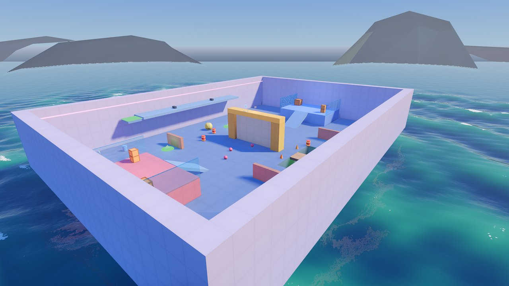
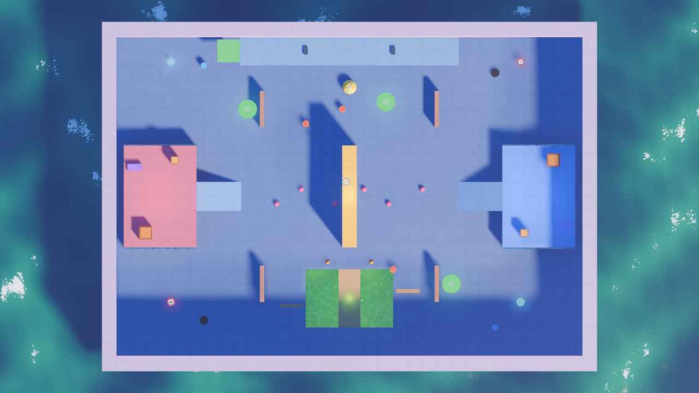
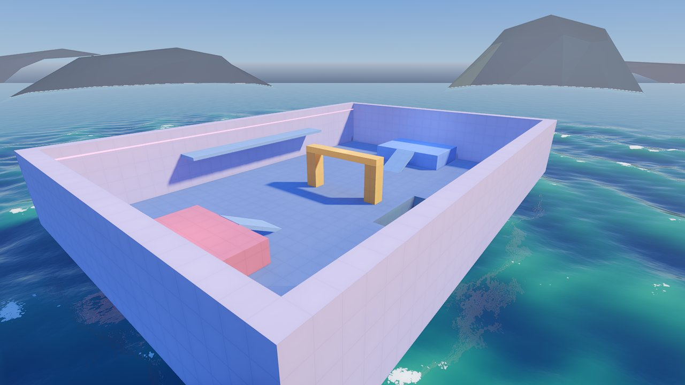
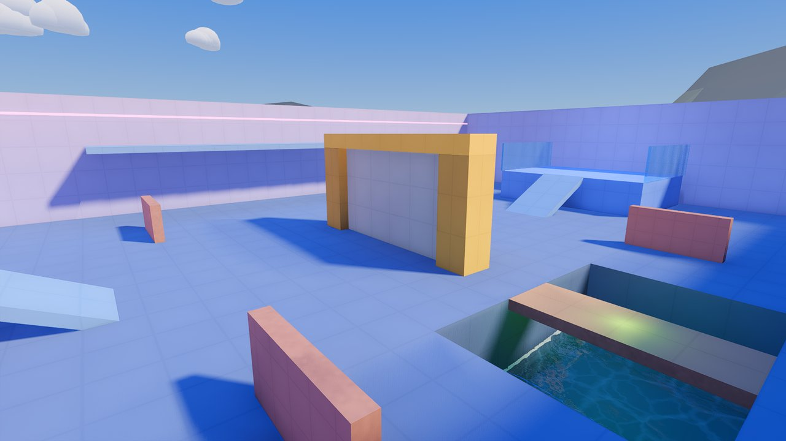
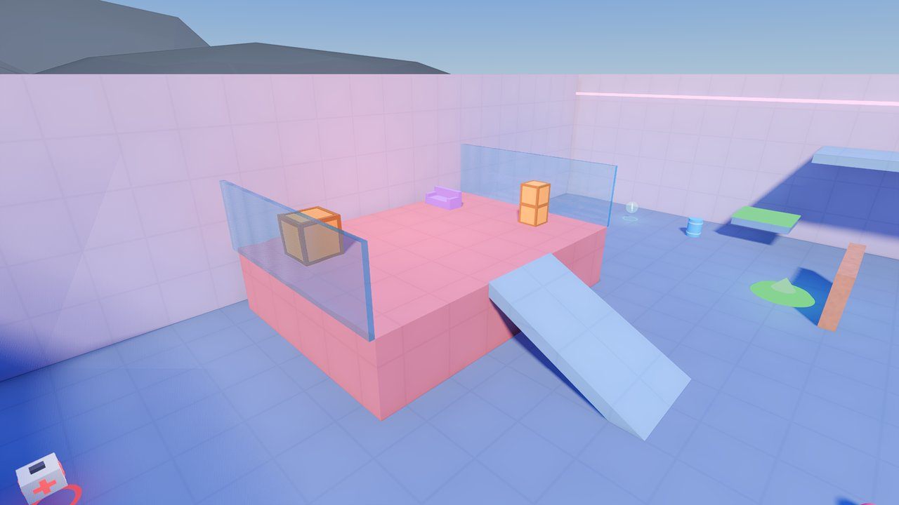
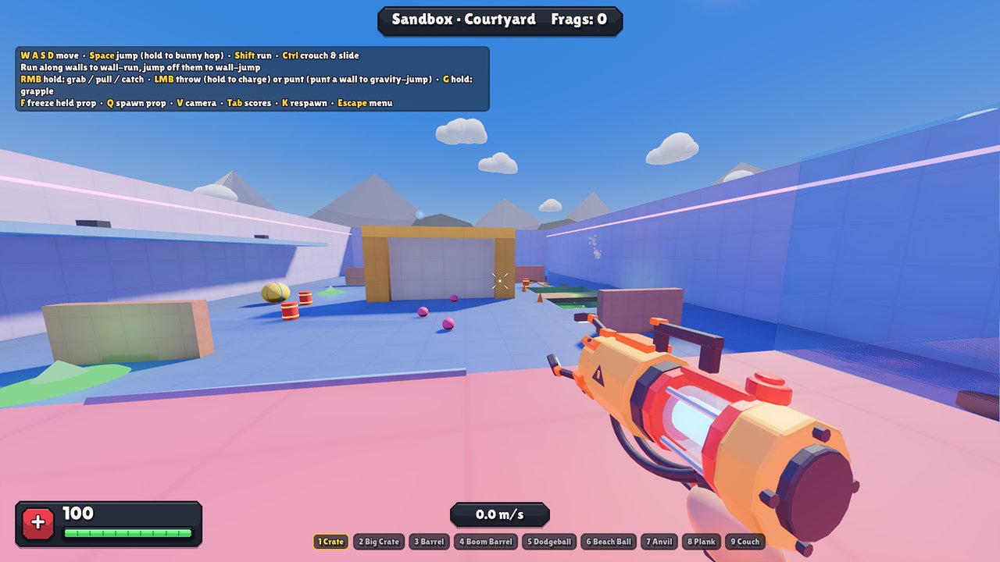

# Rebuild a real map: Courtyard, step by step

This walkthrough builds **Courtyard** again from nothing, piece by piece, in the Godot
editor: the same map the game ships with (`maps/courtyard.tscn`). Every piece, where it goes
and every setting that isn't the default is in the tables below. Follow them and you'll have
learnt most of the Map Kit; after that, any map in the game can be opened and understood the
same way, and changed.



It takes about an hour. New to Godot? Do [Your first custom map](CUSTOM_MAPS_GUIDE.md) first
(15 minutes): it shows where everything is in the editor, and how to play a map you're making.
Every piece has its own page with all its settings: [the pieces](pieces/README.md).

> The tables in this guide are made from `maps/courtyard.tscn` itself
> (`tools/make_guide.gd`), so they always match the map in the game.

---

## 1. The plan

Courtyard is a Capture the Flag map, 64 x 44 m, on a sea fort:



- **The decks**: each team's base, 3 m up at either end (Red at x -26, Blue at x +26), with
  its flag, a ramp down to the yard and glass windows on its sides.
- **The gate wall** across the middle (x 0), between two gold pillars: break it to get
  through (or go round it).
- **The acid trench** to the south, with a wooden bridge over it that breaks.
- **The catwalk** high along the north wall, reached by a lift, a jump pad and an updraft.
- **Brick walls** to hide behind in the yard, and the sea all round (fall in and you're out).

Good to know before you start:

- **x** runs west to east (Red to Blue), **z** north to south, **y** is up. 1 unit is 1 metre;
  a Yeet is about 1.8 m tall and jumps about 2.5 m.
- A **Position** in the tables is the node's position (Inspector > Node3D > Transform >
  Position). A **Rotation** is in degrees (Transform > Rotation).
- **Settings** are the ones to change; leave every other setting as it is. A colour like
  `#6b788f`: click the colour, and paste it into the colour picker's **Hex** box.
- Group the nodes like the map does: plain **Node3D**s named Geometry, Breakables, Spawns,
  Gameplay, Props and Lights, with the pieces under them. Groups don't change how the map
  plays; they keep the Scene dock tidy (fold a group away when you're done with it).

## 2. The scene and its settings

1. In the FileSystem dock, make a folder for it: `custom/my_courtyard/` (right-click
   `custom` > **New > Folder...**).
2. **Scene > New Scene**, **Other Node**, **Node3D**; rename it `MyCourtyard`. Save it
   (Ctrl+S) as `custom/my_courtyard/my_courtyard.tscn`.
3. Add a **MapSettings** (select the root, Ctrl+A, type `MapSettings`) and set:

<!-- nodes res://maps/courtyard.tscn named MapSettings -->
| Setting | Set it to |
|---|---|
| **Map Name** | Courtyard |
| **Author** | Yeetwork Map Kit |
| **Description** | Example map: two team decks on a sea fort, a breakable gate, an acid trench and a catwalk. |
| **Ocean** | on |
| **Ocean Level** | -3 |
| **Sky** | day |
| **Kill Height** | -20 |
| **Avoid Areas** | (-6, 10, 12, 8) |
| **Playtest Bots** | 4 |
<!-- /nodes -->

**Ocean** puts the sea round the map, its surface at **Ocean Level**; **Kill Height** is
where anyone who falls is out. **Avoid Areas** is a rectangle (x, z, width, depth) bots walk
round: the acid trench. Click the Avoid Areas array, **Add Element**, and type the four
numbers.

## 3. The ground and the walls

Add a **Node3D** named `Geometry` under the root, and under it these **ArenaBlock**s. Make
the first one (select Geometry, Ctrl+A, `ArenaBlock`), set its name, Position, Size and
Color; then **duplicate** it (Ctrl+D) for the next, and change what's different. A block's
Position is its middle: the floor blocks, 5 m thick, sit with their tops at y 0.

<!-- nodes res://maps/courtyard.tscn under Geometry -->
| Name | Add | Position | Rotation | Settings |
|---|---|---|---|---|
| FloorWest | [ArenaBlock](pieces/ArenaBlock.md) | (-19, -2.5, 0) |  | Size: (26, 5, 44) |
| FloorEast | [ArenaBlock](pieces/ArenaBlock.md) | (19, -2.5, 0) |  | Size: (26, 5, 44) |
| FloorMidNorth | [ArenaBlock](pieces/ArenaBlock.md) | (0, -2.5, -6) |  | Size: (12, 5, 32) |
| FloorMidSouth | [ArenaBlock](pieces/ArenaBlock.md) | (0, -2.5, 20) |  | Size: (12, 5, 4) |
| TrenchBottom | [ArenaBlock](pieces/ArenaBlock.md) | (0, -5.5, 14) |  | Size: (12, 1, 8); Color: #4d5266 |
| WallNorth | [ArenaBlock](pieces/ArenaBlock.md) | (0, 5, -23) |  | Size: (68, 10, 2); Color: #c7b3db |
| WallSouth | [ArenaBlock](pieces/ArenaBlock.md) | (0, 5, 23) |  | Size: (68, 10, 2); Color: #c7b3db |
| WallWest | [ArenaBlock](pieces/ArenaBlock.md) | (-33, 5, 0) |  | Size: (2, 10, 44); Color: #c7b3db |
| WallEast | [ArenaBlock](pieces/ArenaBlock.md) | (33, 5, 0) |  | Size: (2, 10, 44); Color: #c7b3db |
| RedDeck | [ArenaBlock](pieces/ArenaBlock.md) | (-26, 1.5, 0) |  | Size: (10, 3, 14); Color: #d97380 |
| BlueDeck | [ArenaBlock](pieces/ArenaBlock.md) | (26, 1.5, 0) |  | Size: (10, 3, 14); Color: #738ce6 |
| RedRamp | [ArenaBlock](pieces/ArenaBlock.md) | (-18.05, 1.3, 0) | (0, 0, -26.6) | Size: (6.9, 0.5, 4); Color: #809ecc |
| BlueRamp | [ArenaBlock](pieces/ArenaBlock.md) | (18.05, 1.3, 0) | (0, 0, 26.6) | Size: (6.9, 0.5, 4); Color: #809ecc |
| GatePillarN | [ArenaBlock](pieces/ArenaBlock.md) | (0, 3, -6) |  | Size: (2, 6, 2); Color: #ffbd40 |
| GatePillarS | [ArenaBlock](pieces/ArenaBlock.md) | (0, 3, 6) |  | Size: (2, 6, 2); Color: #ffbd40 |
| GateLintel | [ArenaBlock](pieces/ArenaBlock.md) | (0, 6.5, 0) |  | Size: (2, 1, 14); Color: #ffbd40; Emission: 0.2 |
| Catwalk | [ArenaBlock](pieces/ArenaBlock.md) | (0, 5.75, -20) |  | Size: (30, 0.5, 4); Color: #809ecc |
| NeonNorth | [ArenaBlock](pieces/ArenaBlock.md) | (0, 8.5, -21.95) |  | Size: (64, 0.2, 0.1); Color: #ff8cd9; Emission: 2.5 |
| NeonSouth | [ArenaBlock](pieces/ArenaBlock.md) | (0, 8.5, 21.95) |  | Size: (64, 0.2, 0.1); Color: #ff8cd9; Emission: 2.5 |
<!-- /nodes -->

- The floor is four blocks, not one, to leave a hole for the trench: **FloorMidSouth** and
  **FloorMidNorth** stop short of it, **TrenchBottom** is its floor 5 m down.
- The **ramps** are tilted blocks: Rotation z -26.6 for Red's (rising to the west), +26.6
  for Blue's. Players walk up slopes up to about 46 degrees.
- **NeonNorth** and **NeonSouth** are thin glowing strips (**Emission**) along the walls.

Now **play it**: **F6** (Run Current Scene) starts a match on it with bots. Walk up a ramp
onto a deck, look round, check the sizes feel right. **Esc**, then quit, to come back.



## 4. Walls that break

A **Node3D** named `Breakables`, and under it these **BreakableSlab**s:

<!-- nodes res://maps/courtyard.tscn under Breakables -->
| Name | Add | Position | Rotation | Settings |
|---|---|---|---|---|
| GateWall | [BreakableSlab](pieces/BreakableSlab.md) | (0, 3, 0) | (0, 90, 0) | Size: (10, 6); Anchor Top: on |
| TrenchBridge | [BreakableSlab](pieces/BreakableSlab.md) | (0, -0.25, 14) | (0, 90, 0) | Orientation: FLOOR; Size: (8, 3); Thickness: 0.5; Material: wood; Color: #d99e66; Anchor Bottom: off; Anchor Left: on; Anchor Right: on |
| BrickCover0 | [BreakableSlab](pieces/BreakableSlab.md) | (-12, 1.25, -12) | (0, 90, 0) | Size: (5, 2.5); Material: brick; Color: #eb9473 |
| BrickCover1 | [BreakableSlab](pieces/BreakableSlab.md) | (12, 1.25, -12) | (0, 90, 0) | Size: (5, 2.5); Material: brick; Color: #eb9473 |
| BrickCover2 | [BreakableSlab](pieces/BreakableSlab.md) | (-12, 1.25, 12) | (0, 90, 0) | Size: (5, 2.5); Material: brick; Color: #eb9473 |
| BrickCover3 | [BreakableSlab](pieces/BreakableSlab.md) | (12, 1.25, 12) | (0, 90, 0) | Size: (5, 2.5); Material: brick; Color: #eb9473 |
| RedGlassN | [BreakableSlab](pieces/BreakableSlab.md) | (-26, 4.5, -7.1) |  | Size: (10, 3); Thickness: 0.2; Material: glass; Anchor Left: on; Anchor Right: on |
| RedGlassS | [BreakableSlab](pieces/BreakableSlab.md) | (-26, 4.5, 7.1) |  | Size: (10, 3); Thickness: 0.2; Material: glass; Anchor Left: on; Anchor Right: on |
| BlueGlassN | [BreakableSlab](pieces/BreakableSlab.md) | (26, 4.5, -7.1) |  | Size: (10, 3); Thickness: 0.2; Material: glass; Anchor Left: on; Anchor Right: on |
| BlueGlassS | [BreakableSlab](pieces/BreakableSlab.md) | (26, 4.5, 7.1) |  | Size: (10, 3); Thickness: 0.2; Material: glass; Anchor Left: on; Anchor Right: on |
<!-- /nodes -->

- **GateWall** fills the gap between the gold pillars. It's turned 90 degrees (a slab is a
  WALL along its X), and glued to the world at its bottom and top (**Anchor Bottom**,
  **Anchor Top**): knock a hole in it and the pieces with nothing left to hold onto fall.
- **TrenchBridge** is a FLOOR slab of wood, glued at its two ends (**Anchor Left**,
  **Anchor Right**; Anchor Bottom off): break it and whoever is on it drops into the acid.
- The **glass** windows along the decks are thin (0.2 m) and shatter.



## 5. Getting about, and the hazards

A **Node3D** named `Gameplay`: the flags, the jump pads, the lift and the hazards.

<!-- nodes res://maps/courtyard.tscn under Gameplay -->
| Name | Add | Position | Rotation | Settings |
|---|---|---|---|---|
| RedFlag | [FlagStand](pieces/FlagStand.md) | (-28.5, 3, 0) |  | (as it comes) |
| BlueFlag | [FlagStand](pieces/FlagStand.md) | (28.5, 3, 0) |  | Team: Blue |
| PadToRedDeck | [JumpPadNode](pieces/JumpPadNode.md) | (-14, 0, -12) |  | Target: (-10, 3, 9); Arc Height: 2 |
| PadToBlueDeck | [JumpPadNode](pieces/JumpPadNode.md) | (14, 0, 12) |  | Target: (10, 3, -9); Arc Height: 2 |
| PadToCatwalk | [JumpPadNode](pieces/JumpPadNode.md) | (5, 0, -13) |  | Target: (0, 6, -7); Arc Height: 1.5 |
| CatwalkLift | [LiftPlatform](pieces/LiftPlatform.md) | (-16.6, 0.25, -20) |  | Travel: (0, 5.5, 0) |
| AcidTrench | [HazardVolume](pieces/HazardVolume.md) | (0, -3.5, 14) |  | Size: (12, 3, 8) |
| Updraft | [HazardVolume](pieces/HazardVolume.md) | (17.5, 4, -20) |  | Kind: wind; Size: (3, 8, 3); Wind: (0, 40, 0) |
<!-- /nodes -->

- **FlagStand**s: Capture the Flag needs one Red and one Blue. Each stands on its deck.
- **JumpPadNode**s: **Target** is where it throws you, measured from the pad; select a pad
  and the green arc shows where you'll fly. Drag the Target handle in the 3D view, or type
  it.
- **CatwalkLift**: a **LiftPlatform** that goes 5.5 m up (**Travel**) and back every 8 s,
  to the catwalk.
- **AcidTrench**: a **HazardVolume** of acid (the default Kind) filling the trench.
  **Updraft**: a wind HazardVolume blowing up (40 is more than gravity's 24) at the east end
  of the catwalk.

## 6. Where players start

A **Node3D** named `Spawns`, and under it these **SpawnPoint**s (Team **Any** is the
default):

<!-- nodes res://maps/courtyard.tscn under Spawns -->
| Name | Add | Position | Rotation | Settings |
|---|---|---|---|---|
| Red0 | [SpawnPoint](pieces/SpawnPoint.md) | (-26, 3, -4) |  | Team: Red |
| Red1 | [SpawnPoint](pieces/SpawnPoint.md) | (-26, 3, 4) |  | Team: Red |
| Red2 | [SpawnPoint](pieces/SpawnPoint.md) | (-23.5, 3, 0) |  | Team: Red |
| Red3 | [SpawnPoint](pieces/SpawnPoint.md) | (-29, 0, -12) |  | Team: Red |
| Red4 | [SpawnPoint](pieces/SpawnPoint.md) | (-29, 0, 12) |  | Team: Red |
| Blue0 | [SpawnPoint](pieces/SpawnPoint.md) | (26, 3, -4) |  | Team: Blue |
| Blue1 | [SpawnPoint](pieces/SpawnPoint.md) | (26, 3, 4) |  | Team: Blue |
| Blue2 | [SpawnPoint](pieces/SpawnPoint.md) | (23.5, 3, 0) |  | Team: Blue |
| Blue3 | [SpawnPoint](pieces/SpawnPoint.md) | (29, 0, -12) |  | Team: Blue |
| Blue4 | [SpawnPoint](pieces/SpawnPoint.md) | (29, 0, 12) |  | Team: Blue |
| Any0 | [SpawnPoint](pieces/SpawnPoint.md) | (-15, 0, -15) |  | (as it comes) |
| Any1 | [SpawnPoint](pieces/SpawnPoint.md) | (15, 0, 15) |  | (as it comes) |
| Any2 | [SpawnPoint](pieces/SpawnPoint.md) | (-15, 0, 15) |  | (as it comes) |
| Any3 | [SpawnPoint](pieces/SpawnPoint.md) | (15, 0, -15) |  | (as it comes) |
| Any4 | [SpawnPoint](pieces/SpawnPoint.md) | (0, 6, -20) |  | (as it comes) |
| Any5 | [SpawnPoint](pieces/SpawnPoint.md) | (-8, 0, -3) |  | (as it comes) |
| Any6 | [SpawnPoint](pieces/SpawnPoint.md) | (8, 0, 3) |  | (as it comes) |
<!-- /nodes -->

Team modes use the Red and Blue ones; the others are for everyone (free-for-all, and when a
team has none). Put them on the floor: on a deck that's y 3.

## 7. Props and pickups

A **Node3D** named `Props`, and under it these **PropSpawn**s (set **Kind** on each):

<!-- nodes res://maps/courtyard.tscn under Props -->
| Name | Add | Position | Rotation | Settings |
|---|---|---|---|---|
| Crate0 | [PropSpawn](pieces/PropSpawn.md) | (-24, 3.5, -5) |  | (as it comes) |
| Crate1 | [PropSpawn](pieces/PropSpawn.md) | (-24, 4.5, -5) |  | (as it comes) |
| Cratebig2 | [PropSpawn](pieces/PropSpawn.md) | (-28, 3.9, 5) |  | Kind: crate_big |
| Couch3 | [PropSpawn](pieces/PropSpawn.md) | (-29.5, 3.5, -4) |  | Kind: couch |
| Crate4 | [PropSpawn](pieces/PropSpawn.md) | (24, 3.5, 5) |  | (as it comes) |
| Crate5 | [PropSpawn](pieces/PropSpawn.md) | (24, 4.5, 5) |  | (as it comes) |
| Cratebig6 | [PropSpawn](pieces/PropSpawn.md) | (28, 3.9, -5) |  | Kind: crate_big |
| Couch7 | [PropSpawn](pieces/PropSpawn.md) | (29.5, 3.5, 4) |  | Kind: couch |
| Boombarrel8 | [PropSpawn](pieces/PropSpawn.md) | (-6, 0.6, -10) |  | Kind: boom_barrel |
| Boombarrel9 | [PropSpawn](pieces/PropSpawn.md) | (6, 0.6, 10) |  | Kind: boom_barrel |
| Boombarrel10 | [PropSpawn](pieces/PropSpawn.md) | (-1, 0.6, -12) |  | Kind: boom_barrel |
| Barrel11 | [PropSpawn](pieces/PropSpawn.md) | (-20, 0.6, -18) |  | Kind: barrel |
| Barrel12 | [PropSpawn](pieces/PropSpawn.md) | (20, 0.6, 18) |  | Kind: barrel |
| Anvil13 | [PropSpawn](pieces/PropSpawn.md) | (6, 6.3, -20) |  | Kind: anvil |
| Anvil14 | [PropSpawn](pieces/PropSpawn.md) | (-6, 6.3, -20) |  | Kind: anvil |
| Plank15 | [PropSpawn](pieces/PropSpawn.md) | (-8, 0.1, 15) |  | Kind: plank |
| Plank16 | [PropSpawn](pieces/PropSpawn.md) | (8, 0.1, 13) |  | Kind: plank |
| Beachball17 | [PropSpawn](pieces/PropSpawn.md) | (0, 1, -15) |  | Kind: beachball |
| Tire18 | [PropSpawn](pieces/PropSpawn.md) | (-20, 0.3, 17) |  | Kind: tire |
| Tire19 | [PropSpawn](pieces/PropSpawn.md) | (20, 0.3, -17) |  | Kind: tire |
| Cone20 | [PropSpawn](pieces/PropSpawn.md) | (-3, 0.4, 9) |  | Kind: cone |
| Cone21 | [PropSpawn](pieces/PropSpawn.md) | (3, 0.4, 9) |  | Kind: cone |
| Ball22 | [PropSpawn](pieces/PropSpawn.md) | (-10, 0.4, 1) |  | Kind: ball |
| Ball23 | [PropSpawn](pieces/PropSpawn.md) | (-6, 0.4, -1) |  | Kind: ball |
| Ball24 | [PropSpawn](pieces/PropSpawn.md) | (-2, 0.4, 1) |  | Kind: ball |
| Ball25 | [PropSpawn](pieces/PropSpawn.md) | (2, 0.4, -1) |  | Kind: ball |
| Ball26 | [PropSpawn](pieces/PropSpawn.md) | (6, 0.4, 1) |  | Kind: ball |
| Ball27 | [PropSpawn](pieces/PropSpawn.md) | (10, 0.4, -1) |  | Kind: ball |
<!-- /nodes -->

A prop that's destroyed or falls in the sea comes back at its spot a while later. Put props
a little above the floor (a crate's middle is 0.5 m up): they drop into place.

And five **PickupSpawn**s, straight under the root:

<!-- nodes res://maps/courtyard.tscn script res://scripts/mapkit/pickup_spawn.gd -->
| Name | Add | Position | Rotation | Settings |
|---|---|---|---|---|
| Pickup1 | [PickupSpawn](pieces/PickupSpawn.md) | (-0.5, 7, -2) |  | Kind: random |
| Pickup2 | [PickupSpawn](pieces/PickupSpawn.md) | (23.5, 0, -18.5) |  | (as it comes) |
| Pickup3 | [PickupSpawn](pieces/PickupSpawn.md) | (23.5, 0, 14.5) |  | Kind: random |
| Pickup4 | [PickupSpawn](pieces/PickupSpawn.md) | (-24.5, 0, -18.5) |  | Kind: random |
| Pickup5 | [PickupSpawn](pieces/PickupSpawn.md) | (-24.5, 0, 14.5) |  | Kind: health_big |
<!-- /nodes -->

The one on the gate's lintel (Pickup1) is a random power-up for whoever dares the climb.



## 8. Lights

A **Node3D** named `Lights` with four plain Godot **OmniLight3D**s (Ctrl+A, `OmniLight3D`):
a red glow over Red's deck, a blue one over Blue's, a green one over the acid and a warm one
over the gate.

<!-- nodes res://maps/courtyard.tscn under Lights -->
| Name | Add | Position | Rotation | Settings |
|---|---|---|---|---|
| RedBase | OmniLight3D | (-26, 7, 0) |  | Light Color: #ff6673; Light Energy: 2.5; Omni Range: 14 |
| BlueBase | OmniLight3D | (26, 7, 0) |  | Light Color: #668cff; Light Energy: 2.5; Omni Range: 14 |
| Trench | OmniLight3D | (0, 0.5, 14) |  | Light Color: #73ff33; Light Energy: 2; Omni Range: 10 |
| Gate | OmniLight3D | (0, 8, 0) |  | Light Color: #ffd980; Light Energy: 1.5; Omni Range: 10 |
<!-- /nodes -->

(**Omni Range** is under Omni in the Inspector, **Light Color** and **Light Energy** under
Light.) Any Godot light, decal, particles or mesh can go in a map as it is.

## 9. Check it, and compare

1. **F6**: play a round. Capture a flag, break the gate, ride the lift, fall in the acid.
2. **The map check**: it finds what's missing or wrong (no flag for a team, a spawn in a
   wall, a piece with a bad setting). In a terminal in the project folder:

   ```bash
   godot --headless --path . -- --map res://custom/my_courtyard/my_courtyard.tscn --validate
   ```

   It prints what it found, and `OK` when it's happy.
3. **Compare** with the real one: open `maps/courtyard.tscn` in another tab. Click the same
   piece in both and compare their Inspectors.



## 10. Make it yours

It's your map now. Some ideas, each a minute's work:

- **Sky** `storm` in MapSettings: rain, wind and lightning that sets the crates alight.
- The gate wall as **glass** (Material) or **wood** (it burns), or tougher (**Hp Scale** 3).
- A **MapLight** `torch` on each deck; **Sky** `night`.
- Swap the crates for your own (a **PropType**: see the guide's *Your own versions*).
- A second lift on the south side; another updraft over the trench.

To play it in the game (not only from the editor), make it a **map pack**: steps 14 to 16 of
[Your first custom map](CUSTOM_MAPS_GUIDE.md).

Every other map in `maps/` is built the same way: open one, click through its pieces, read
their pages in [the pieces](pieces/README.md). Next: [Make a new map](MAKE_A_NEW_MAP.md), from
an idea of your own.
